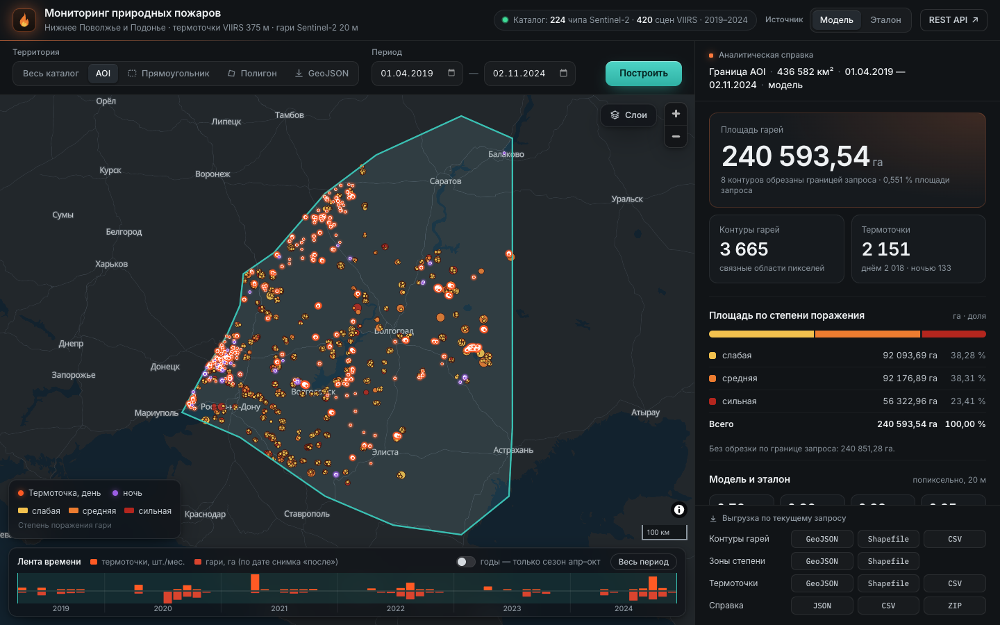
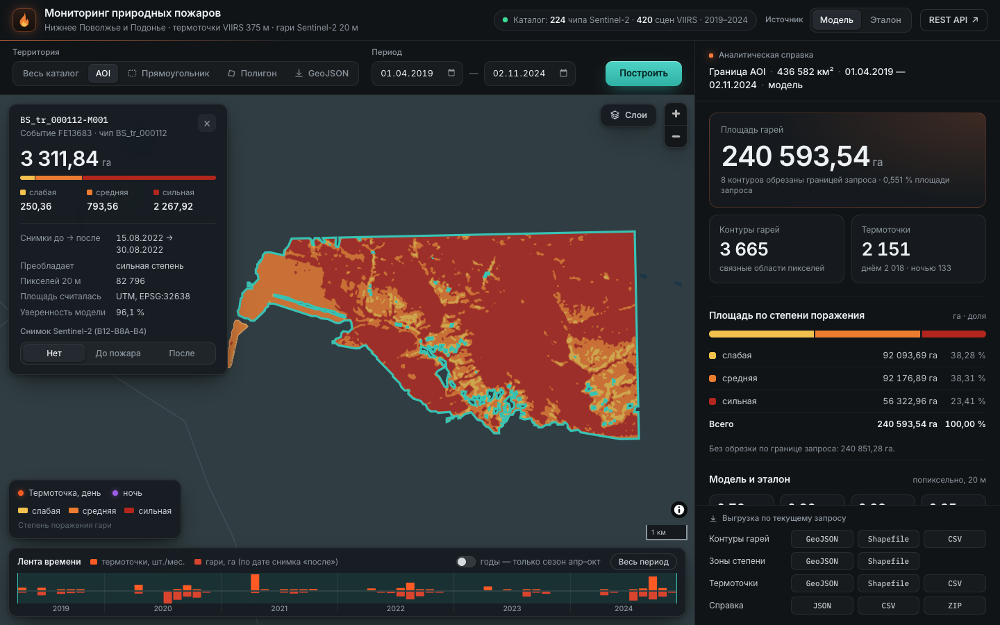

# Двухэтапный мониторинг природных пожаров по данным ДЗЗ

Решение команды LitWin для КосмоХакатона 2026 (Красноярск), кейс «Мониторинг природных пожаров»: по спутниковым снимкам находить активное горение, контуры гарей и степень поражения, а результаты показывать в картографическом сервисе с REST API.

**Score 0.833** на 5-fold CV по пространственным кластерам · **0.8622** на public-части теста · весь тест за **25 с** на RTX 3060 · подробный [технический отчёт](REPORT.md) ([PDF](reports/REPORT.pdf))



Комплекс из двух модулей и информационно-аналитического сервиса:

1. **Детекция активного горения** (VIIRS I1–I5, 375 м): контекстные признаки в духе алгоритма VNP14IMG + градиентный бустинг, который отделяет природное горение от техногенных и отражающих источников.
2. **Картирование гарей и степени поражения** (Sentinel-2 до/после, Sentinel-1, рельеф, покров, 20 м): модели предсказывают *область пожара* (ансамбль U-Net / UNet++ с энкодерами RegNetY и ResNet-34, каналами дальнего и глобального контекста, и GBDT на многомасштабных признаках), степень внутри неё — по порогам dNBR постановки, сглаженному медианой как в эталоне.
3. **Сервис** (FastAPI + MapLibre): запрос по полигону/прямоугольнику и интервалу дат → карта термоточек, векторные контуры гарей, справка по площадям с выгрузкой в GeoJSON / Shapefile / GPKG / JSON / CSV, REST API.

**Стек:** Python 3.12 · PyTorch 2.6 · segmentation_models_pytorch · timm · LightGBM · rasterio / pyproj / shapely · FastAPI · MapLibre GL JS · Docker

## Быстрый старт

```bash
pip install -r requirements.txt                                          # Python 3.12, версии зафиксированы
bash scripts/download_weights.sh                                         # чекпойнты сетей BS из Releases (~210 МБ)
python inference.py --data-dir /path/to/test --output submission.csv     # 25 с на RTX 3060
pip install -r service/requirements.txt && uvicorn service.app.main:app --port 8000   # сервис: http://localhost:8000/
```

---

## Результаты (5-fold CV по пространственным кластерам, OOF на всём train)

| Компонента | Классический baseline* | Наше решение | Вклад в Score |
|---|---|---|---|
| F1_af (активное горение) | 0.891 | **0.962** | 0.337 |
| IoU_burn (контур гари) | 0.365 | **0.757** | 0.265 |
| mIoU_sev (слабая / средняя / сильная) | 0.177 | **0.772** (0.634 / 0.798 / 0.885) | 0.232 |
| **Score** | **0.493** | **0.833** | |
| **Score на public-части теста (платформа, 19.09.2026)** | — | **0.8622** | |

В OOF каждая модель предсказывает пространственные кластеры, которых не видела при обучении; финальные модели обучены на всём train. Финальный `submissions/submission.csv` (md5 `b159562917dcaf5b42f906f269a05b82`) — **0.8622** на public. Оба уточнения процедуры эталона дали на public тот же прирост, что и на OOF: правило «медиана классов» 0.8596 → 0.8615, минимальная площадь объекта 1 га → 0.8622. OOF использовалась для выбора моделей, поэтому это не независимая оценка; результат на private заранее неизвестен.

\* Фиксированные пороги VNP14IMG для AF и dNBR со шкалой USGS для BS, посчитанные тем же скриптом метрики. Организаторы baseline не выдавали. Разбор и абляции — в [REPORT.md](REPORT.md).

Ключевые находки: эталон AF — выход контекстного алгоритма VIIRS; степень поражения — интервалы dNBR между порогами постановки с медианой 3×3 по растру классов (согласие 99.1 %); контур гари — «правило ∩ область события» (буфер ≈3 км вокруг очагов) минус облака и тени по SCL, без объектов мельче 1 га (25 px). Поэтому модели BS предсказывают именно область события.

## Схема пайплайна

```
AF-чип: VIIRS I1–I5, углы, покров, рельеф, метео                        ┐
  → контекстные признаки VNP14IMG в окнах 7–41 px (torch, GPU)           │  маска 0/1
  → кандидаты (мягкие пороги, полнота 99.6 %) → LightGBM ×3 → порог F1   ├──────────┐
                                                                          ┘          │
BS-чип: Sentinel-2 до/после + SCL, Sentinel-1 VV/VH, рельеф, покров     ┐          ▼
  правило:     dNBR → пороги по типу покрова → медиана 3×3 классов 0..3  │   submission.csv
  исключение:  SCL до/после ∈ {нет данных, тень, вода, облако, снег}     │   (RLE, 447 строк)
  область пожара — взвешенное среднее вероятностей:                      │          ▲
     U-Net RegNetY ×3, U-Net ResNet-34, UNet++ (вход 40 м, 94–104 канала)│  маска 0..3
     GBDT (блоки 40 м, контекст 160 м – 5 км; параллельно на CPU)         ├──────────┘
  гарь = P > t ∩ правило ∩ не исключено, объекты ≥ 1 га;  степень = правило ┘
```

## Требования

* Linux x86_64 (проверено на Ubuntu 24.04), **Python 3.12** (зафиксированный numpy 2.5 не ставится на более старые версии);
* GPU NVIDIA с CUDA 12.x — желательно (на CPU инференс работает, но медленнее); отдельная установка CUDA не нужна — колёса torch 2.6.0 с PyPI уже содержат CUDA 12.4, достаточно драйвера NVIDIA;
* ~6 ГБ RAM для инференса, ~16 ГБ RAM и GPU от 12 ГБ для обучения;
* несколько ГБ диска под окружение (torch с библиотеками CUDA), ~60 МБ под репозиторий и ~210 МБ под чекпойнты сетей;
* доступ в интернет нужен только при установке зависимостей, скачивании весов и обучении сетей (скачиваются ImageNet-веса энкодеров); **инференс работает без сети**.

## Установка

```bash
git clone https://github.com/lexeler/wildfire-monitoring-eo.git && cd wildfire-monitoring-eo
python3 -m venv .venv && source .venv/bin/activate     # python3 --version → 3.12.x
pip install -r requirements.txt          # все версии зафиксированы (==)
bash scripts/download_weights.sh         # чекпойнты сетей BS из GitHub Releases, со сверкой sha256
pytest tests -q                          # необязательно: самопроверка RLE, метрики, формата готового сабмита, конфигураций и обхода деревьев (~1 с, без GPU и без данных)
```

Модели LightGBM/GBDT и все конфигурации лежат в `weights/` в репозитории; пять чекпойнтов сетей (29–53 МБ каждый) опубликованы как ассеты [релиза v1.0](https://github.com/lexeler/wildfire-monitoring-eo/releases/tag/v1.0) — `scripts/download_weights.sh` скачивает их в `weights/` и сверяет контрольные суммы.

или Docker (предпочтительно; образ `python:3.12-slim`, CUDA 12.4 из колёс torch — на хосте нужен только драйвер NVIDIA и nvidia-container-toolkit):

```bash
bash scripts/download_weights.sh         # веса нужны до сборки образа
docker build -t litwin-fire .            # в образ попадают код, конфигурации и веса
```

## Данные

Ожидаемая структура (как в выданном наборе):

```
<test_dir>/
  sample_submission.csv
  af/viirs/<chip_id>_VIIRS_I1-I5.tif
  af/aux/<chip_id>_AUX.tif
  bs/sentinel2_pre/<chip_id>_Sentinel-2_pre.tif      bs/sentinel2_post/<chip_id>_Sentinel-2_post.tif
  bs/sentinel1_pre/<chip_id>_Sentinel-1_pre.tif      bs/sentinel1_post/<chip_id>_Sentinel-1_post.tif
  bs/aux/<chip_id>_AUX.tif
<train_dir>/  — то же + af/masks, bs/masks, af/meta.csv, bs/meta.csv
```

## Веса: подготовка и подключение

Готовые веса собираются в `weights/`: конфигурации и модели бустинга — в репозитории, чекпойнты сетей (`*.pt`) — из релиза через `bash scripts/download_weights.sh`. `inference.py` берёт веса оттуда по умолчанию:

```
weights/
  af_config.json                 модуль AF: список моделей, порог, имена 117 признаков
  af_lgbm_s0.txt … af_lgbm_s2.txt   три модели LightGBM (усредняются)
  af_cv_report.json              OOF-метрики AF (справочно)
  bs_config.json                 модуль BS: список сетей, GBDT, веса бленда, порог, TTA
  bs_ctx2_s2.pt  bs_unetpp_ctx_s2.pt  bs_rgy16_s42.pt  bs_rgy16_s7.pt  bs_rgy32.pt   сети области пожара (fp16, из Releases)
  bs_gbdt_s1.txt (+ bs_gbdt_s1.json — параметры и имена признаков)               GBDT области пожара
```

* Состав моделей читается из `af_config.json` и `bs_config.json` — пути и пороги в коде не зашиты.
* Другой каталог весов (например, переобученных): `python inference.py ... --weights /path/to/weights`.
* Получить веса с нуля — `python train.py --data-dir /path/to/train` создаёт тот же набор файлов в `./weights` (см. «Обучение»).

## Инференс → submission.csv

```bash
python inference.py --data-dir /path/to/test --output /path/to/submission.csv
```

Команда не требует правок кода и конфигураций: на входе каталог теста в структуре из раздела «Данные», на выходе — готовый `submission.csv` (447 строк для выданного теста, формат постановки). Машина без GPU — та же команда (устройство определяется само) либо явно `--device cpu`.

Docker:

```bash
docker run --rm --gpus all -v /path/to/test:/data:ro -v "$PWD/out":/out litwin-fire
# → out/submission.csv
```

Скрипт обрабатывает все чипы из `sample_submission.csv`, включая облачные, и завершается с кодом 0. Сбой на отдельном чипе не роняет прогон: нехватка памяти GPU → батч делится пополам, в пределе — расчёт на CPU; иные ошибки → запасной ответ с предупреждением в лог.

**Время и воспроизводимость** (весь тест, 269 чипов): **25 с** на RTX 3060 12 ГБ + 12 ядер CPU, включая загрузку весов и чтение растров; в Docker — 27 с вместе с запуском контейнера. Из них сети BS на GPU — 14.5 с, поэтому на H100 ожидается ~10 с. Число процессов GBDT подбирается по доступным ядрам (учитываются cpuset и квота CPU контейнера). Два прогона дают побитно одинаковый файл, Docker-прогон совпадает с прогоном без Docker. Готовый результат для тестового набора — `submissions/submission.csv`.

Проверка формата и, при наличии эталона, подсчёт метрики (код возврата 0 — ошибок нет):

```bash
python scripts/validate_submission.py --submission /path/to/submission.csv --data-dir /path/to/test
```

Проверка воспроизводимости — два прогона в разные файлы и сравнение контрольных сумм:

```bash
python inference.py --data-dir /path/to/test --output /tmp/run1.csv
python inference.py --data-dir /path/to/test --output /tmp/run2.csv
sha256sum /tmp/run1.csv /tmp/run2.csv    # суммы совпадают -> метрика совпадает точно
```

Параметры: `--weights` (каталог весов), `--device auto|cuda|cpu`, `--workers` (потоки чтения), `--gbdt-workers` (процессы GBDT; по умолчанию — по числу доступных ядер с учётом cpuset и квоты CPU контейнера), `--dump-probs DIR` (отладка: вероятности по чипам, на результат не влияет).

## Обучение

```bash
python train.py --data-dir /path/to/train          # веса -> ./weights
python train.py --data-dir /path/to/train --cv     # + 5-fold CV и OOF-анализ для отчёта
python train.py --data-dir /path/to/train --only af   # только один модуль: af | bs
```

То же в Docker (веса пишутся в примонтированный каталог, чтобы не затирать готовые):

```bash
docker run --rm --gpus all -v /path/to/train:/data:ro -v "$PWD/weights_new":/weights_new litwin-fire \
    python train.py --data-dir /data --out /weights_new
# затем: python inference.py ... --weights weights_new
```

* параметры: `--out` (каталог весов, по умолчанию `./weights`), `--work-dir` (промежуточные чекпойнты и OOF, по умолчанию `./runs`);
* фолды зафиксированы в `configs/folds_{af,bs}.csv` (пересоздание: `python scripts/make_folds.py --data-dir ...`);
* состав ансамбля, гиперпараметры сетей, веса бленда и порог — `configs/bs_ensemble.json`; по нему `train.py` собирает `weights/bs_config.json`, который читает инференс;
* все случайные начальные значения закреплены: `firemon.utils.seed_everything` (python, numpy, torch), seed каждой сети — в `configs/bs_ensemble.json` (по умолчанию 42), LightGBM — `deterministic=True` с явными seed;
* при обучении сетей скачиваются ImageNet-веса энкодеров (нужен интернет); инференсу сеть не нужна.

Отдельные шаги: `python -m firemon.af.train`, `python -m firemon.bs.train`, `python scripts/bs_gbdt_cv.py` (у каждого `--help`).

## Сервис

```bash
pip install -r service/requirements.txt
uvicorn service.app.main:app --host 0.0.0.0 --port 8000
# UI: http://localhost:8000/   API: http://localhost:8000/docs
```

или `docker compose -f service/docker-compose.yml up --build`. Эндпоинты и примеры `curl` — в [service/README.md](service/README.md).

* **Запрос:** территория (AOI, прямоугольник, полигон на карте, файл GeoJSON) и интервал дат; период можно выбрать протяжкой по ленте времени.
* **Карта:** термоточки VIIRS (день/ночь), контуры гарей по преобладающей степени, попиксельный растр степени 20 м, снимки Sentinel-2 до и после пожара. Подложка векторная, без государственных границ.
* **Справка:** площадь гарей в гектарах (UTM, по пикселям 20 м), площади и доли трёх степеней, гари по типам покрова, динамика термоточек, сравнение модели с эталоном (IoU, F1).
* **Выгрузка:** GeoJSON, Shapefile (`.prj`, `.cpg`), GeoPackage, CSV, JSON, ZIP — с атрибутами (id, класс, площадь), в WGS84 или UTM. Всё то же доступно через REST API.

Каталог построен на OOF-прогнозах модели по сценам train: у тестовых чипов нет геопривязки. Переключатель «Модель / Эталон» показывает разметку организаторов для сравнения.



## Структура репозитория

```
inference.py            точка входа инференса (submission.csv)
train.py                точка входа обучения (оба модуля)
firemon/                пакет решения
  io.py rle.py metric.py utils.py      данные: чтение чипов; RLE; метрика соревнования; сиды и таймер
  af/  features.py                     модуль AF — признаки (контекст VNP14IMG, пороги кандидатов)
       model.py predict.py             модель (LightGBM по кандидатам) и инференс
       train.py                        обучение, OOF и подбор порога
  bs/  rules.py                        модуль BS — правило степени: пороги dNBR по покрову, медиана 3×3 классов, исключение SCL
       features.py model.py train.py   признаки, сети «область события», их обучение
       gbdt.py gbdt_infer.py           GBDT области и его параллельный инференс
       predict.py                      ансамбль и сборка маски
configs/                фолды CV (folds_*.csv), состав ансамбля и гиперпараметры (bs_ensemble.json)
weights/                конфигурации инференса (пороги, веса бленда) и модели бустинга; чекпойнты сетей — в Releases
submissions/submission.csv   результат инференса на тестовом наборе
scripts/                воспроизведение чисел отчёта и служебные шаги (см. ниже)
service/                информационно-аналитический сервис (FastAPI + MapLibre, каталог прогнозов)
reports/                REPORT.pdf, рисунки, факты EDA, журнал экспериментов
tests/                  юнит-тесты (RLE, метрика, формат сабмита, согласованность конфигураций, обход деревьев); тесты сервиса — service/tests
```

Параметры решения вынесены из кода: пороги и состав моделей инференса — `weights/af_config.json`, `weights/bs_config.json`; рецепт обучения ансамбля — `configs/bs_ensemble.json`; предметные константы с пояснениями источника (пороги VNP14IMG, пороги dNBR постановки, исключаемые классы SCL) — в начале `firemon/af/features.py` и `firemon/bs/rules.py`.

**Эксперименты, не вошедшие в финальный пайплайн** (оставлены для воспроизведения таблиц раздела 6 отчёта; `inference.py` и `train.py` их не используют):

| Файл | Что это | Итог |
|---|---|---|
| `firemon/af/cnn.py`, `scripts/af_blend_eval.py` | U-Net по картам признаков AF и его бленд с LightGBM | прироста нет (отчёт, 6.1, A9) |
| `firemon/bs/severity.py`, `scripts/bs_severity_cv.py` | GBDT-модель степени вместо правила порогов | +0.0014, но ~10 с CPU — отказ (6.3) |
| `firemon/gbdt_torch.py` | точный обход деревьев LightGBM на GPU | не понадобился: CPU-пул укладывается в бюджет (раздел 7) |
| `scripts/bs_component_analysis.py`, `scripts/bs_morph_analysis.py` | «один пожар на чип», морфология области | хуже базового варианта (6.3) |
| вторая ступень GBDT (`final="s2"` в `firemon/bs/predict.py`, `gbdt_infer.py`) | автоконтекст по карте вероятностей | переобучение на OOF — выключена в `bs_config.json` (6.3) |
| опции `firemon/bs/train.py`: `--soft-dir/--soft-alpha`, `--drop-fold`; `scripts/bs_make_soft_targets.py`; `--soft-oof` в `firemon/af/train.py` | дистилляция ансамбля (мягкие цели) и её вложенная проверка | «прирост» обычной CV оказался утечкой через учителя — отказ (6.4) |
| опции `firemon/bs/train.py`: `--ema`, `--coord`, `--hot`, `--dec-attn`, `--drop-path`, `--lovasz`, `--aux-frac`; `--pos/--hot` в `scripts/bs_gbdt_cv.py` | вторая серия гипотез: EMA, каналы положения, «видимый огонь» на Sentinel-2, scSE, stochastic depth, Lovász, вспомогательная голова | прироста нет (6.4); по умолчанию выключены |
| `scripts/bs_oof_repredict.py` | пересчёт OOF готовых моделей с другим числом TTA | TTA 8 → 4 → 1: 0.4940 → 0.4929 → 0.4917 (6.4) |
| опции `firemon/bs/train.py`: `--smooth`, `--boot`, `--gce`, `--chdrop`, `--noise`, `--no-aug`; `scripts/bs_stem_train.py`, `scripts/bs_modality_train.py` | серия из 32 гипотез на 5 GPU: устойчивые к шуму разметки лоссы, регуляризация входа, инициализация первого слоя по спектральным каналам, гиперпараметры | подтверждённого прироста нет; SWIR-инициализация первого слоя (`--stem-mode swir_pair`) дала +0.0035 на OOF, но −0.0045 на public — отвергнута (6.4, журнал) |
| `scripts/bs_candidate_eval.py` | парное сравнение вариантов правила и состава бленда на OOF: по фолдам и с бутстрепом по пространственным кластерам | так принято правило «медиана классов» (+0.0023, 95 % интервал +0.0017…+0.0031) |

Назначение остальных скриптов: `make_folds.py` — фолды; `eda_report.py`, `baselines.py` — разделы 2–3 отчёта; `bs_gbdt_cv.py` — CV и финальная модель GBDT (вызывается из `train.py`); `bs_oof_analysis.py`, `bs_blend_search.py` — анализ OOF и подбор весов бленда; `assemble_weights.py` — сборка `weights/` из готовых чекпойнтов; `make_result_figures.py` — рисунки результатов; `export_oof_preds.py` — прогнозы для каталога сервиса; `validate_submission.py` — проверка формата сабмита и метрика; `download_weights.sh` — загрузка чекпойнтов сетей из Releases.

## Лицензии и внешние ресурсы

Открытое ПО: PyTorch (BSD), segmentation_models_pytorch (MIT), timm (Apache-2.0), LightGBM (MIT), rasterio (BSD), FastAPI (MIT), MapLibre GL JS (BSD-3). Предобученные энкодеры ImageNet: [RegNetY-016 tv2](https://huggingface.co/timm/regnety_016.tv2_in1k) (BSD-3-Clause), [RegNetY-032 ra](https://huggingface.co/timm/regnety_032.ra_in1k) (Apache-2.0), [ResNet-34](https://huggingface.co/smp-hub/resnet34.imagenet) (исходные веса torchvision; сведения о лицензировании — в разделе 11 отчёта). Использованы только как инициализация, внешние данные пожаров не привлекались. Сервис: подложка — векторные тайлы [OpenFreeMap](https://openfreemap.org) / [OpenMapTiles](https://openmaptiles.org), данные © участники [OpenStreetMap](https://www.openstreetmap.org/copyright) (ODbL); слой «Спутник» — Esri World Imagery; шрифты Inter и IBM Plex Mono (SIL OFL).
