# Отчёт: двухэтапный мониторинг природных пожаров по данным ДЗЗ

**Команда LitWin** · КосмоХакатон 2026 · кейс «Мониторинг природных пожаров»

> Коротко. Мы разобрали, как устроена эталонная разметка обоих модулей, и построили решение вокруг этого понимания.
> **AF:** эталон — это выход контекстного алгоритма VIIRS VNP14IMG (минимумы I4 и I4−I5 у пикселей горения ровно на его порогах), поэтому модуль воспроизводит его статистики как признаки и доучивает решение бустингом: F1 0.891 → **0.962**.
> **BS:** эталон = «класс по порогам dNBR (пороги рис. 6 постановки; затем медиана 3×3 по растру классов)» ∩ «область события — буфер ≈3 км вокруг очагов пожара» ∖ «облака/тени/вода по SCL». Степень внутри гари восстанавливается правилом с согласием 99.1 %, а главная задача — найти область события; её решает ансамбль сетей (U-Net с энкодерами RegNetY и ResNet-34, UNet++) с каналами дальнего и глобального контекста и GBDT на многомасштабных признаках. Вклад BS в Score: 0.181 (шкала USGS) → **0.494**.
> Итоговый OOF-Score на 5-fold пространственной CV: **0.833** (классический baseline 0.493); на public-части теста (платформа, 19.09.2026) — **0.8622**. Инференс всего теста — 25 с на RTX 3060.
> **Сервис** (веб-интерфейс и REST API со Swagger): запрос по территории и периоду, карта термоточек и гарей со степенью поражения, справка по площадям в гектарах, выгрузка в GeoJSON, Shapefile, GeoPackage, CSV.

## Содержание

1. [Задача и протокол оценки](#1-задача-и-протокол-оценки)
2. [Разбор данных: наблюдение → решение](#2-разбор-данных-наблюдение--решение)
3. [Baseline и отправная точка](#3-baseline-и-отправная-точка)
4. [Модуль AF: детекция активного горения](#4-модуль-af-детекция-активного-горения)
5. [Модуль BS: гари и степень поражения](#5-модуль-bs-гари-и-степень-поражения)
6. [Эксперименты и абляции](#6-эксперименты-и-абляции)
7. [Инженерные и предметные решения](#7-инженерные-и-предметные-решения)
8. [Итоговое решение](#8-итоговое-решение)
9. [Выводы, ошибки, ограничения, развитие](#9-выводы-ошибки-ограничения-развитие)
10. [Воспроизводимость](#10-воспроизводимость)
11. [Лицензии и источники](#11-лицензии-и-источники)

---

## 1. Задача и протокол оценки

**Задача.** По AF-чипу VIIRS (256×256, 375 м) выделить пиксели природного горения. По BS-чипу Sentinel-2/1 (512×512, 20 м) выделить гарь и отнести каждый её пиксель к слабой, средней или сильной степени. Итоговая метрика — микро-усреднение по пулу пикселей всех чипов:

`Score = 0.35·F1_af + 0.35·IoU_burn + 0.30·mIoU_sev`

Максимальный вклад AF — 0.35, BS — 0.65. Поэтому основные усилия пошли в BS.

**Схема валидации.** Тест отличается от train и территорией, и временем (закрытая часть — весь 2025 год и другие участки). Случайное разбиение по чипам завышает качество: в AF одни и те же 70 тайлов повторяются в разные даты, и модель запоминает конкретные источники. Поэтому:

* центры обучающих чипов переведены в WGS84 и разбиты KMeans на 15 пространственных кластеров; кластеры разложены по 5 фолдам GroupKFold (`scripts/make_folds.py`, фиксированный seed 42, результат сохранён в `configs/folds_{af,bs}.csv`);
* во всех сравнениях метрика считается по **OOF-прогнозам всех 224 BS / 420 AF чипов сразу** (микро-усреднение, как у организаторов), а не как среднее по фолдам;
* для AF проверено, что тайловая группировка даёт более оптимистичный F1: 0.971 против 0.962 на пространственных кластерах. В отчёте везде приведена строгая оценка;
* параметры постобработки (порог, веса бленда) подбираются по OOF на грубой сетке. На тех же фолдах сравнивались архитектуры, рецепты обучения и правила степени. Поэтому OOF — оценка для выбора решения, а не независимая оценка после выбора: многократный перебор может её завышать. Private-метрика заранее неизвестна. Для принятия нового варианта дополнительно сравниваем изменения по фолдам, повторяем перспективные рецепты с другим seed и учитываем стоимость инференса.

Скрипт метрики (`firemon/metric.py`) реализует формулы постановки: TP/FP/FN суммируются по всем чипам; если класс отсутствует и в эталоне, и в прогнозе, величина равна 1. Юнит-тесты — `tests/test_rle_metric.py`.

---

## 2. Разбор данных: наблюдение → решение

Все числа воспроизводятся скриптом `python scripts/eda_report.py --data-dir <train>` (рисунки — `reports/figures/eda_*.png`, числа — `reports/eda_facts.json`).

### 2.1 AF: дисбаланс и природа разметки

| Наблюдение | Число | Решение |
|---|---|---|
| Пиксели горения — крошечная доля | 9 725 из 27.5 млн (**0.035 %**, 1 : 2 829); 296 чипов с горением, 124 без | Классификатор учится не на всех пикселях, а на **кандидатах** (мягкий фильтр по I4, I4−I5 и превышению над фоном): 379 тыс. строк вместо 27.5 млн при полноте кандидатов 99.64 %. Порог выбирается по F1 на OOF, без балансировки весов |
| Горение распределено по чипам неравномерно | медиана 21 px на чип с горением (максимум 243); 10 % чипов содержат 43 % всех пикселей горения; на ночь приходится 12 % пикселей горения при 30 % ночных чипов | Метрика микро-усреднённая, поэтому порог и все сравнения считаем по общему пулу OOF-пикселей, а не по чипам: несколько крупных событий весят больше сотни мелких |
| У пикселей горения I4 и ΔT=I4−I5 начинаются ровно на порогах VNP14IMG | ночь: min I4 = **295.0 K**, min ΔT = **10.0 K**; день: 99.3 % проходят «I4>325 & ΔT>25» | Эталон — продукт контекстного алгоритма VIIRS. Модуль воспроизводит его статистики (фон в окнах 7–41 px без облаков и потенциальных очагов, отклонения, z-оценки) и отдаёт решение бустингу |
| Только фиксированные пороги дают много ложных | F1 0.891 (P 0.81, R 0.99); ночью P = 0.67 | Главный резерв — точность, а не полнота |
| Горение кластерами, половина пикселей не локальный максимум | 3 287 кластеров, медиана 2 px; локальных максимумов I4 только 52.6 % | Признаки соседства: число потенциальных очагов в 3×3 и 5×5, разность с максимумом соседей |
| Техногенные источники удалены из эталона лишь частично | 97 точек горячи ≥3 дат, 91 % из них — застройка; горячая застройка помечена горением в 49 % случаев (против 83 % вне застройки) | Без геопривязки теста «память о месте» недоступна. Работаем через одиночный снимок: доля застройки/пашни/воды в окнах, яркость SWIR (блики), погода и рельеф |
| Покров: где горит и где ошибаются пороги | травы — 37 % пикселей горения при 20 % территории (обогащение 1.8×); застройка — 3.7 % при 1.3 % (2.9×); на застройку приходится 16 % ложных срабатываний порогов, на воду — 1.5 % | Класс покрова одного пикселя техногенный источник не отсекает, но сдвигает априорную вероятность. Поэтому в признаки идут не только класс, но и доли застройки, пашни, воды и леса в окнах |
| Полосы NaN (bow-tie deletion VIIRS) и доля валидных пикселей | полосы есть в 52 % чипов, всегда при зенитном угле сенсора ≥ 34.7°; 11 % пикселей горения граничат с NaN. Невалидны 8.3 % всех пикселей, но `meta.valid_frac` этого не видит: он < 1 лишь у 14 чипов (край полосы обзора) | Валидность считаем сами по пикселям (I4 и I5 конечны, valid = 1), на `meta.valid_frac` не опираемся. Фоновые статистики считаются только по валидным пикселям; доля валидных в чипе — признак уровня снимка. Чипы 409–420, которые организаторы назвали «побитыми», — те же полосы bow-tie; мы их не исключали |

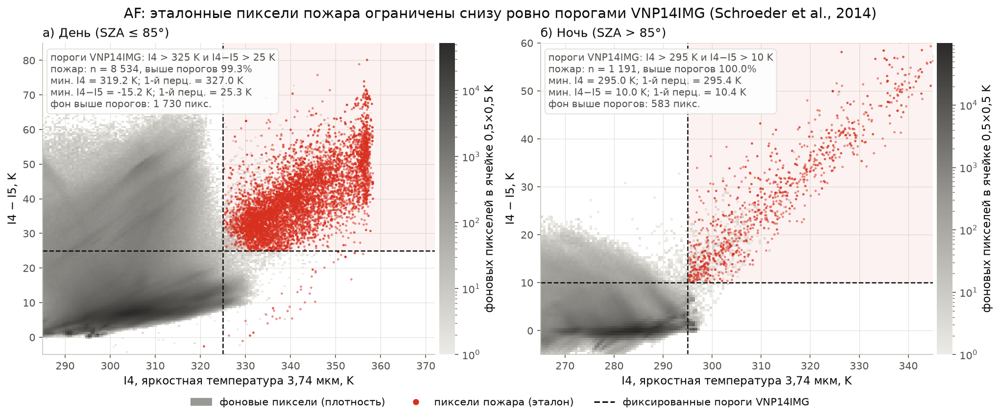
*Рис. 2.1. AF: I4 и ΔT пикселей горения начинаются ровно на фиксированных порогах VNP14IMG → эталон порождён контекстным алгоритмом VIIRS, его статистики берём как признаки.*

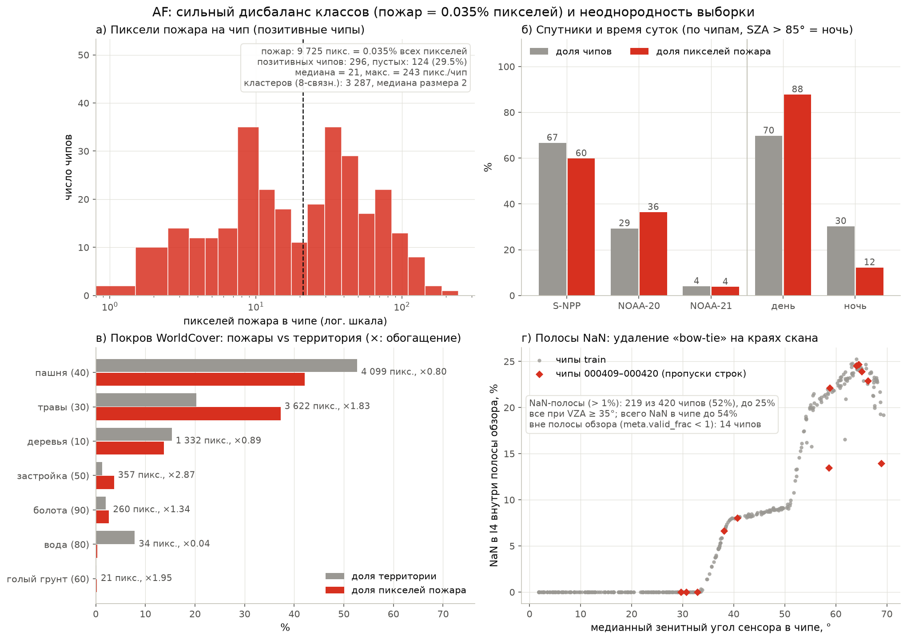
*Рис. 2.2. AF: дисбаланс 1 : 2 829 и распределение горения по чипам и покрову → обучение на кандидатах, порог по F1 общего пула.*

### 2.2 BS: как устроен эталон

Это главное наблюдение работы, от него зависит вся архитектура модуля.

**(а) Степень — это интервалы dNBR, сглаженного медианой 3×3, между порогами постановки.** Мы перебрали способы получения класса по правилу (пороги рис. 6 постановки по типу покрова) и сравнили с эталоном внутри гари:

| Вариант dNBR | сырой | среднее 3×3 | гаусс σ=1 | мода классов 3×3 | **медиана 3×3** |
|---|---|---|---|---|---|
| Согласие с эталоном | 0.938 | 0.954 | 0.950 | 0.979 | **0.985** |

Ошибки сырого варианта сосредоточены на границах классов (12.6 % против 2.4 % внутри); после медианы — 3.4 % и 0.3 %. **Уточнение (вторая серия, раздел 6.4).** Ещё точнее эталон воспроизводит другой порядок операций: сначала класс по *сырому* dNBR и порогам своего покрова, затем пиксели, исключённые по SCL, обнуляются, и только потом берётся медиана 3×3 — уже по растру классов 0–3 (обычная для ГИС «чистка» классифицированного растра). Согласие степени внутри гари растёт с 98.6 % до 99.1 % (с учётом пикселей, где правило даёт «не горело»: 97.2 % → 97.7 %), прирост есть на всех пяти фолдах. Медиана по dNBR и медиана по классам расходятся там, где в окне 3×3 смешаны типы покрова с разными порогами. Модели по-прежнему получают на вход правило по медианному dNBR (на нём они обучены), а итоговая маска собирается по уточнённому правилу (`rules.output_rule`, `severity_mode = class_median`).

**Минимальная площадь объекта.** В эталоне нет мелких гарей: из 4 997 связных компонент (8-связность, бинарная маска гари) только 4 меньше 25 пикселей, а самый частый размер — ровно 25 px, то есть 1 га при разрешении 20 м. Организаторы применяли к итоговой маске «сито» минимальной картируемой площади (обычный шаг перед векторизацией). Мелкие дыры, наоборот, не заливались (702 дыры размером в 1 пиксель). Поэтому из итоговой маски прогноза мы удаляем связные объекты меньше 25 px (`rules.sieve_small`, `min_area_px = 25`): +0.0007 на каждом из пяти фолдов и +0.0007 на public.

**Решение:** степень внутри гари задаётся правилом (`firemon/bs/rules.py`), без обучения. Для травы и пашни пороги постановки на train оптимальны (согласие 98.9 % и 99.0 %). Для леса и болот эмпирическая граница 2|3 сдвинута: 0.575 вместо 0.66 и 0.61 вместо 0.677. Мы откалибровали её перебором и получили согласие 0.907→0.919 и 0.928→0.943 (в целом по гари 0.985 → 0.986: на лес и болота приходится лишь 6 % гари).

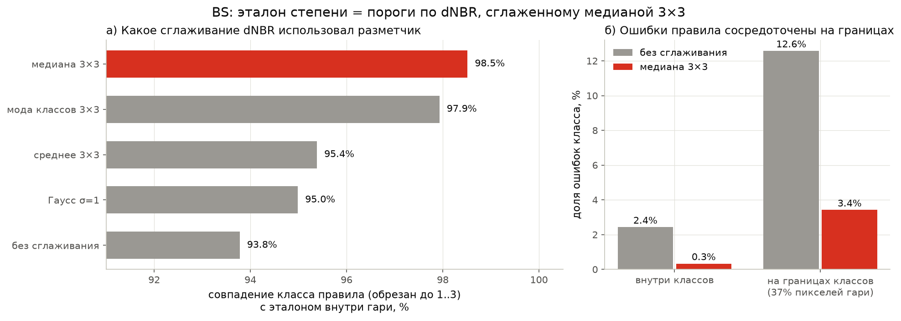
*Рис. 2.3. BS: согласие правила с эталоном при разных сглаживаниях dNBR и доля ошибок внутри классов и на их границах → в правиле используем медиану 3×3.*

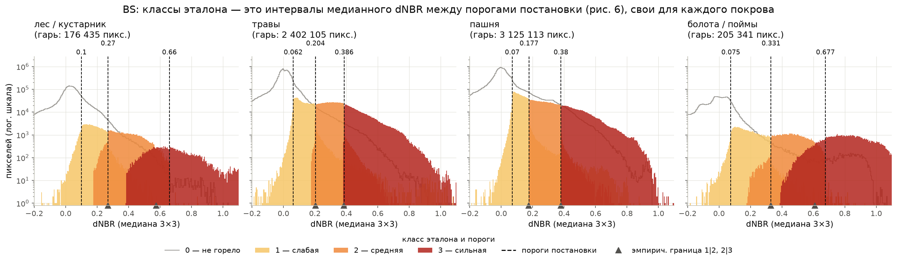
*Рис. 2.4. BS: классы эталона — интервалы медианного dNBR между порогами своего покрова → степень задаём правилом, граница 2|3 для леса и болот откалибрована.*

**(б) Контур гари — не порог.** 98.5 % пикселей гари удовлетворяют правилу (dNBR выше порога «не горело»). Но из пикселей, удовлетворяющих правилу, гарью размечены лишь 36 %: 10.2 млн «правило есть, гари нет» против 5.8 млн гари. Одно правило даёт IoU_burn = 0.43. Значит, эталон дополнительно ограничен **областью события**.

**(в) Область события — буфер ≈3 км вокруг очагов пожара.** Там, где правило разрешает гарь, а эталон нет, граница — дуги окружностей: 51 % такой границы, RANSAC нашёл 994 окружности с медианным радиусом 2.4 км. Для 18 чипов BS в окно дат попали наши AF-чипы, и мы наложили их очаги:

* 90 % пикселей гари лежат в пределах 3.25 км от очага;
* P(гарь | правило) = 0.83 в пределах 1 км, 0.35 на 3–4 км, 0.02 на 7–8 км;
* «правило ∩ буфер R вокруг очагов» даёт максимум IoU 0.69 при R = 3.0 км (одно правило — 0.46).

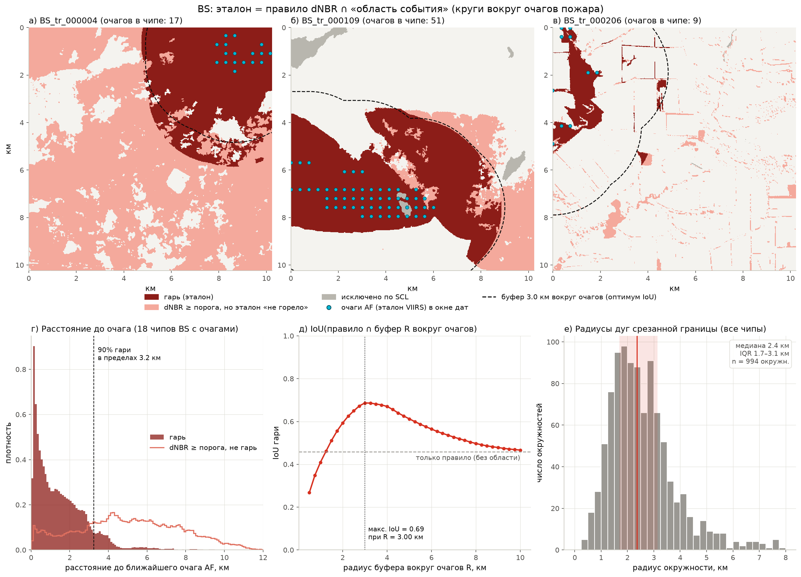
*Рис. 2.5. BS: эталон = правило ∩ область события. Вверху — три чипа с очагами AF и буфером 3 км; внизу — расстояние гари до очага, IoU «правило ∩ буфер R» и радиусы дуг срезанной границы → цель обучения — область события.*

**Решение:** модели предсказывают не «гарь», а **область события**. Цель обучения — принадлежность области; лосс считается только на пикселях, где правило допускает гарь (остальные в эталоне всегда 0). Области нужен дальний контекст на 100–200 px, поэтому сеть получает каналы плотности гари и расстояний до ядер сильной гари, а GBDT — многомасштабные признаки в окнах 160 м–5 км.

**(г) Облака, тени, вода по SCL.** Доля размеченной гари среди пикселей, удовлетворяющих правилу, при SCL «до» **или** «после» ∈ {0 нет данных, 3 тень облака, 6 вода, 9 облако высокой вероятности, 11 снег} равна 0.000–0.005.

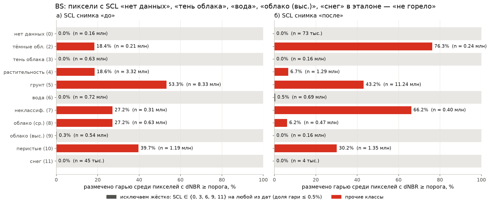
*Рис. 2.6. BS: доля размеченной гари среди пикселей, удовлетворяющих правилу, по классам SCL «до» и «после» → классы {0, 3, 6, 9, 11} исключаем жёстко, остальные отдаём моделям как входы.*

**Решение:** жёсткое исключение этих пикселей. Оно даёт +0.066 IoU_burn и +0.075 mIoU_sev (B2→B3 в таблице раздела 3) и почти ничего не стоит по полноте: под исключение попадает 4 782 пикселя гари из 5.8 млн (0.08 %). Остальные классы SCL (8 — облако средней вероятности, 10 — перистые, 2 — тёмные области, где часто сама гарь) не исключаются: доля гари среди них 0.06–0.76. Сеть видит их как входы.

**(д) Распределение степени, покров и регион.** Гарь — 10.1 % пикселей BS (в чипе от 0.01 до 56 %, медиана 7.5 %; чипов без гари нет). Классы степени внутри гари: 40.0 / 37.1 / 22.9 % — дисбаланс умеренный, балансировка классов степени не нужна. Слабая степень — самая массовая и граничит с «не горело», поэтому ошибки контура бьют прежде всего по ней: у чистого правила (B3) IoU по классам 0.29 / 0.52 / 0.74, тогда как при идеальном контуре правило даёт mIoU 0.97. **Вывод:** резерв mIoU_sev — в контуре, а не в порогах классов.

Различия по типам покрова (группы порогов постановки):

| Группа покрова | Доля территории | Горит внутри группы | Доля от всей гари | Слабая / средняя / сильная, % | Согласие правила с эталоном |
|---|---|---|---|---|---|
| лес / кустарник | 7.7 % | 3.9 % | 3.0 % | 51 / 38 / 11 | 0.907 (после калибровки 0.919) |
| травы | 34.9 % | 11.7 % | 40.7 % | 37 / 39 / 24 | 0.989 |
| пашня | 50.4 % | 10.6 % | 52.9 % | 42 / 36 / 22 | 0.990 |
| болота / поймы | 6.9 % | 5.1 % | 3.5 % | 38 / 27 / 35 | 0.928 (после калибровки 0.943) |

Горят в основном травы и пашня (94 % гари), лес и болота — 6 %. Правило с порогами трав для леса и болот даёт там согласие 0.67 и 0.65 вместо 0.91 и 0.93; выбор порогов по доминирующему покрову чипа — 0.959 по всей гари вместо 0.985 у попиксельного. Мажоритарное сглаживание карты покрова согласие либо не меняет (окно 3: 0.986), либо снижает (окна 5 и 9: 0.984 и 0.981), поэтому покров берём попиксельно.

Различия по территории: доля сильной степени 35 % на 38–40° в. д. против 15–25 % восточнее; на 46–48° в. д. пожары в разы крупнее (медиана 2 306 га на чип против 562–943 га в остальных полосах, гарью занято 19.8 % площади чипов против 7.7–10.4 %). Различия по годам незначимы (Краскела–Уоллиса p = 0.24).

**Решение:** пороги выбираются попиксельно по группе покрова (правило), покров входит в признаки моделей; отдельные модели по покрову не строим — на лес и болота приходится 6 % гари, там достаточно калибровки границы 2|3. Масштаб события меняется по территории в несколько раз, поэтому модели получают контекст уровня чипа (квантили dNBR, доли классов правила), а схема CV — пространственная: оценка включает перенос на территорию с другим масштабом пожаров и другим составом степеней.

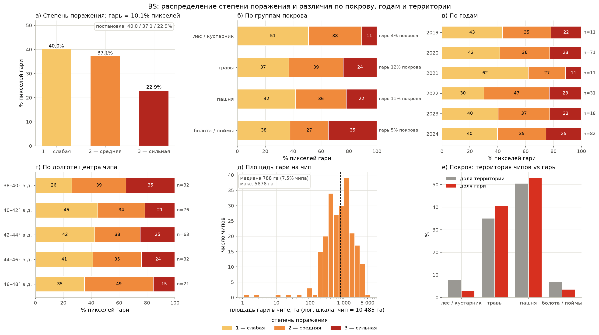
*Рис. 2.7. BS: распределение степени поражения в целом, по группам покрова, годам и долготе; площадь гари на чип; покров территории и гари → пороги по покрову, пространственная CV.*

**(е) Облачность и доля валидных пикселей.** В метаданных BS `valid_frac = 1 − cloud_frac` точно, то есть это одна величина. Ближе всего к `meta.cloud_frac` доля пикселей с исключаемым SCL {0, 3, 6, 9, 11} на любой из дат (MAE 0.038), а не сумма «облачных» классов 8–10 (MAE 0.06–0.19). Исключаемые пиксели занимают в среднем 9.6 % чипа (медиана 2.8 %, максимум 73 %); облачность > 10 % у 31 % чипов. При этом облачность чипа не связана с долей гари (Спирмен ρ = 0.03, p = 0.67; медианная доля гари 6.9 % при облачности ≤ 10 % и 7.7 % при > 10 %, Манна–Уитни p = 0.60). **Решение:** облака обрабатываются попиксельно (исключение по SCL + SCL как вход моделей), а не на уровне чипа: чипы не фильтруем и не взвешиваем по облачности, в лоссе участвуют только неисключённые пиксели, а доля исключённых пикселей в чипе — один из каналов контекста уровня чипа. Инференс на сильно облачном чипе работает так же, как на чистом: исключённая часть получает «не горело», как в эталоне. Сравнение облачности train и test — в разделе 2.3.

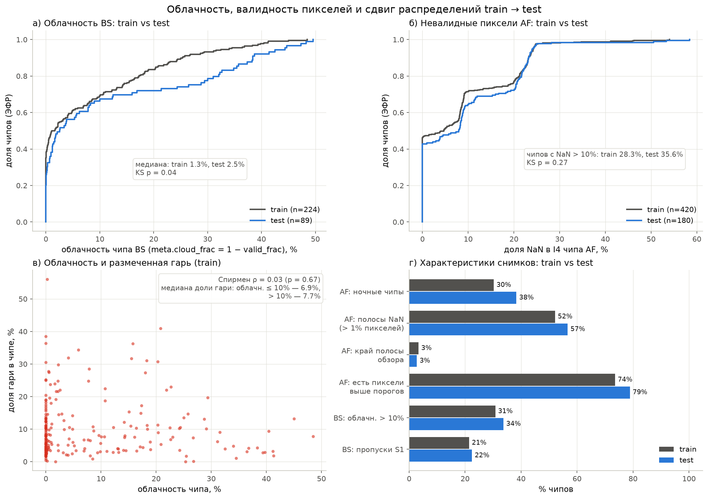
*Рис. 2.8. Облачность BS и невалидные пиксели AF в train и test, связь облачности с долей гари, характеристики снимков train/test → облака и NaN обрабатываем попиксельно; сдвиг разобран в разделе 2.3.*

**(ж) Радар: характер шума.** S1 покрывает не весь чип у 21 % чипов (нулевые значения; чипов совсем без S1 нет). Спекл в однородных окнах 7×7 без гари: σ ≈ 1.6 дБ (VV, ENL ≈ 7.7) и 2.1 дБ (VH, ENL ≈ 4.4). Сигнал гари в ΔVH ≈ 0.5 дБ при шуме разности 2.9 дБ на пиксель и 1.5 дБ после окна 7×7, то есть отношение сигнал/шум 0.19 на пикселе и 0.37 после сглаживания (у dNBR — 25). Одиночный признак ΔVV/ΔVH даёт AUC 0.53–0.55, лучший (ΔVH 7×7 в лесу) — 0.62; у dNBR — 0.95. Мы отдельно проверили идею «радар верифицирует контур»: внутри зоны, которую правило dNBR уже разрешило (именно там надо отличить пожар от поля), ΔVH 7×7 даёт AUC 0.62 в лесу, но 0.51 на травах и пашне, где лежит 94 % гари. Знак эффекта соответствует физике (в лесу VH падает сильнее: −0.68 дБ против −0.13 дБ у фона), но на 20 м он тонет в спекле. **Решение:** радар — только вспомогательные сглаженные каналы моделей с маской покрытия: подсказка там, где оптика неуверенна или закрыта. Отдельный радарный детектор и жёсткую радарную проверку контура не строим.

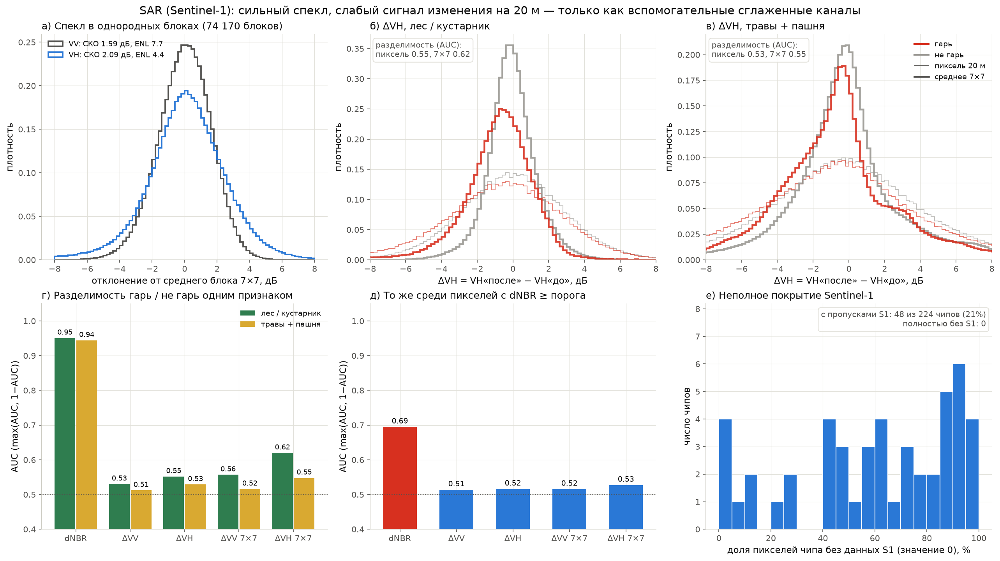
*Рис. 2.9. Sentinel-1: спекл, распределения ΔVH для гари и фона, AUC одиночных признаков по всем пикселям и внутри зоны правила, неполное покрытие → радар только как сглаженные вспомогательные каналы с маской покрытия.*

**(з) Пара «до/после» и фенология.** Пары снимков заданы организаторами: интервал между «до» и «после» — от 10 до 50 дней, медиана 15. За это время dNBR растёт и без пожара (уборка, вспашка, засуха): правилу удовлетворяют 16.1 млн пикселей, а гарью размечены 5.8 млн из них (36 %). Величина индекса эти случаи не разделяет: по всем пикселям dNBR отличает гарь с AUC 0.95, но внутри зоны правила — только 0.69 (травы и пашня 0.69, лес 0.77). **Решение:** не подбирать пороги dNBR дальше, а учить модель отличать событие пожара от фенологии по форме, контексту и спектральным признакам самого выгорания (разделы 5 и 7.1). Дату и сезон в признаки не включаем: в тесте их нет.

### 2.3 Сдвиг train→test и устойчивость решения

Закрытая часть теста — весь 2025 год и другие территории, открытая — 2019–2024. Геопривязка и даты тестовых чипов удалены, поэтому сравнить можно только характеристики самих снимков, и только по всему тесту сразу (public и private неразделимы). Сравнение — рис. 2.8 и таблица:

| Характеристика | train | test | Проверка |
|---|---|---|---|
| AF: ночные чипы (SZA > 85°) | 30 % | **38 %** | — |
| AF: чипы с долей NaN > 10 % | 28 % | 36 % | KS по доле NaN: p = 0.27 |
| AF: чипы с полосами NaN (> 1 % пикселей) | 52 % | 57 % | — |
| AF: чипы с пикселями выше порогов VNP14IMG | 74 % | 79 % | медиана 11 и 11 px на чип, KS p = 0.85 |
| AF: чипы на краю полосы обзора (`valid_frac` < 1) | 3.3 % | 2.8 % | KS p = 1.0 |
| BS: облачность, медиана / среднее | 1.35 % / 8.1 % | **2.55 % / 12.1 %** | KS p = 0.04 |
| BS: чипы с облачностью > 10 % | 31 % | 34 % | — |
| BS: медианная доля исключаемого SCL | 2.8 % | 3.9 % | — |
| BS: чипы с неполным покрытием S1 | 21 % | 22 % | — |

Заметных сдвигов два: в тесте больше ночных сцен AF и немного больше облаков в BS. Остальное совпадает. Территориальный и временной сдвиг содержимого (другие участки, 2025 год) по обезличенным чипам измерить нельзя, поэтому устойчивость к нему заложена в схему оценки и в конструкцию решения.

**Ночные сцены.** Ночью фиксированные пороги работают хуже, чем днём (P 0.67 и F1 0.80 против P 0.83 и F1 0.90), хотя на ночь приходится лишь 12 % пикселей горения. Поэтому ночной режим в модели явный: свои пороги кандидатов (290 K, 6 K), флаг ночи и ночной тест облачности в признаках. Раздельные пороги вероятности для дня и ночи прироста не дали (F1 0.962, A10 в разделе 6.1), то есть единый порог на плато F1 не зависит от доли ночных сцен.

**Почему решение переносит сдвиг:**

1. *Оценка учитывает смену территории.* Все числа отчёта — OOF на 5 фолдах по 15 пространственным кластерам: модель всегда проверяется на участках, которых не видела. Менее строгое тайловое разбиение завышает F1 на 0.009 (A8). Разброс F1 по фолдам (0.936–0.978) — наша оценка того, насколько качество AF меняется от территории к территории.
2. *Степень поражения задаётся правилом.* Это детерминированная функция dNBR и покрова с порогами постановки и небольшой калибровкой по train. Такое ограничение уменьшает число обучаемых параметров, но не гарантирует перенос на другую процедуру разметки.
3. *Признаки без привязки к месту и времени.* AF опирается на отклонения от локального фона и z-оценки; BS — на высоту относительно среднего по чипу, без абсолютной высоты, координат, дат и сезона.
4. *Облака и невалидные пиксели обрабатываются попиксельно* (разделы 2.1, 2.2 г, е): более облачный тест означает лишь больше исключённых пикселей, и эталон устроен так же.
5. *Ансамбль разнородных моделей.* Сети и GBDT на явных признаках ошибаются по-разному; различие между seed на отдельных фолдах достигает 0.05, бленд уменьшает этот разброс. Используем грубую сетку весов, а порог AF берём в середине плато F1. Устойчивость соседних настроек снижает чувствительность к выбору параметров, но сама по себе не исключает переобучение на OOF.
6. *Тест не используется* ни для дообучения, ни для псевдоразметки, ни для сопоставления чипов между собой (правила соревнования).

Сдвиг по времени внутри train слаб: доля сильной степени по годам значимо не различается (p = 0.24). Отдельной валидации «по годам» мы не проводили — пространственные кластеры содержат чипы всех лет; это ограничение оценки отмечено в разделе 9.3.

---

## 3. Baseline и отправная точка

Организаторы baseline не выдали: на вопрос в чате площадки, предоставят ли baseline вместе с тестовыми данными, 18.09 ответили дословно «Уточнили у коллег, бейзлайна не будет». Поэтому точку отсчёта мы реализовали сами — классический индексный baseline из теоретической части постановки: пороги VNP14IMG для AF и dNBR со шкалой USGS для BS. Он посчитан тем же скриптом метрики на всём train (`scripts/baselines.py`, `reports/baselines.json`). Кодирование и декодирование RLE (по постановке они входят в состав baseline) и скрипт метрики мы тоже реализовали сами по описанию в постановке (`firemon/rle.py`, `firemon/metric.py`, тесты в `tests/test_rle_metric.py`).

На второй экспертной сессии организаторы уточнили, что отправной точкой считается первый загруженный результат команды, а ценится путь улучшений от него. Наш путь на public-части теста: первый загруженный сабмит — **0.8596**, после уточнения правила степени («медиана классов») — **0.8615**, после учёта минимальной площади объекта эталона (1 га) — **0.8622**; кандидат с SWIR-инициализацией двух сетей дал 0.8570 и был отвергнут (раздел 6.4). Внутренний путь от классического baseline (0.493 на OOF) до 0.833 разобран по шагам в разделе 6.

**Назначение.** (1) Нижняя граница качества на той же метрике и тех же данных — от неё отсчитываются все приросты в разделе 6. (2) Сквозная проверка конвейера «чтение чипов → маска → RLE → метрика» до появления моделей. (3) Источник физически осмысленных признаков: оба компонента baseline остались внутри финального решения — пороги VNP14IMG задают кандидатов и контекстные признаки AF, правило dNBR задаёт степень и допустимую зону BS.

**Компоненты baseline по модулям.**

* *AF:* чтение I4 и I5 → день или ночь по зенитному углу Солнца (граница 85°) → фиксированные пороги VNP14IMG (день I4 > 325 K и ΔT > 25 K; ночь I4 > 295 K и ΔT > 10 K) → бинарная маска. Вариант A1 добавляет контекстные тесты окна 11×11 (ΔT > μ+3.5σ, ΔT > μ+6 K, I4 > μ+3σ) по фону без облаков и потенциальных очагов.
* *BS:* NBR = (B8A − B12)/(B8A + B12) на обе даты → dNBR = NBR(до) − NBR(после) → пороги шкалы USGS, единые для всего чипа → классы 0–3; контур гари — класс ≥ 1. Далее по шагам добавляем то, что предписывает постановка: пороги по типу покрова, сглаживание, исключение по SCL.

| Вариант | F1_af | IoU_burn | mIoU_sev | Score |
|---|---|---|---|---|
| AF-пороги + dNBR по шкале USGS | 0.891 | 0.365 | 0.177 | **0.493** |
| + пороги по типу покрова (рис. 6) | 0.891 | 0.352 | 0.400 | 0.555 |
| + медиана 3×3 по dNBR | 0.891 | 0.360 | 0.439 | 0.570 |
| + исключение по SCL | 0.891 | 0.427 | 0.514 | **0.615** |

**Сильные стороны.** Физическая интерпретируемость; нет обучения; почти полная полнота AF (0.994); правильная степень, где контур верен.

**Слабые стороны и ограничения:**

1. *AF:* нет фильтрации техногенных источников и отражающих поверхностей. Точность 0.81, ночью 0.67. Контекстные тесты с жёсткими коэффициентами снижают полноту сильнее, чем поднимают точность (F1 0.869).
2. *BS, фиксированные пороги на разнородном покрове:* одна шкала USGS даёт mIoU 0.18 — в степи dNBR физически не достигает лесных значений.
3. *BS, контур:* порог по dNBR ловит убранные и вспаханные поля, фенологию, края облаков. Точность контура низкая (IoU 0.35–0.43 при полноте 98.5 %).
4. *Облака:* без SCL ложные изменения на краях облаков и теней.

**Гипотезы, вытекающие из слабых сторон, и что из них вышло.** Каждая гипотеза отвечает на конкретное ограничение baseline; последние два столбца показывают, что именно мы улучшали и какой рост это дало.

| # | Из какого ограничения | Гипотеза и что меняли | Где проверена | Результат |
|---|---|---|---|---|
| H1 | слабая сторона 1: жёсткие пороги, нет фильтрации техногенных источников | Те же контекстные статистики VNP14IMG, но как признаки обучаемой модели, а не как пороги с фиксированными коэффициентами: точность вырастет без потери полноты | 6.1, A0 → A2 | Подтвердилась: F1 0.891 → 0.962, точность 0.807 → 0.953 при полноте 0.971 |
| H2 | слабая сторона 2: одна шкала dNBR на разнородном покрове | Степень — детерминированная функция dNBR и покрова; её надо не учить, а точно воспроизвести (пороги рис. 6, правильное сглаживание), а ошибка BS — это ошибка контура | 2.2 а, 6.2 (B0→B3), 6.3 | Подтвердилась: согласие правила с эталоном 0.985, mIoU 0.177 → 0.514 без обучения; сеть вместо правила хуже на 0.011–0.024 |
| H3 | слабая сторона 3: порог по dNBR ловит поля и фенологию | Контур = «правило ∩ область события»; область — крупная гладкая форма масштаба 3–5 км, её можно предсказать по дальнему контексту | 6.2 (B3 → C1 → C4) | Подтвердилась: +0.116 bs_part на переходе к модели области, +0.019 на каналах дальнего контекста; IoU_burn 0.427 → 0.756 |
| H4 | слабая сторона 4: облака и тени дают ложные изменения | Предметные решения (исключение SCL, дальний контекст) дадут больше, чем усложнение архитектуры сети | 6.2, 6.3 | Подтвердилась частично: SCL +0.046, контекст +0.019, а более ёмкий энкодер ResNet-50 дал −0.029. Но смена типа энкодера на RegNetY дала +0.019 — столько же, сколько контекст, поэтому архитектуру мы всё же перебрали |
| H5 | общее: у правила и у сети разные слепые зоны | Модели разной природы (сеть на форме и GBDT на явных многомасштабных признаках) дополняют друг друга | 6.2 (E1–E5, финал) | Подтвердилась: +0.018 к лучшей одиночной модели на раннем ансамбле, +0.013 в финале (0.481 → 0.494) |


## 4. Модуль AF: детекция активного горения

Код: `firemon/af/features.py`, `model.py`, `train.py` (и экспериментальный `cnn.py`).

**Признаки (117 карт, torch, CPU/GPU, один код для обучения и инференса):**

* каналы I1–I5, ΔT = I4−I5, зенитные углы, флаг ночи (SZA > 85°), I1+I2, NDVI-подобный индекс, I3/I2 (блик в SWIR);
* тесты облачности VNP14IMG (день: I5 < 265 K или I1+I2 > 0.9 и I5 < 295 K и т.д.; ночь: I5 < 265 K), вода по покрову;
* «потенциальные очаги» по порогам VNP14IMG исключаются из фона. Для окон 7, 11, 21, 41 px по валидному безоблачному фону считаются среднее и СКО I4, I5, ΔT; от них — отклонения и z-оценки пикселя; также доля фона, доли потенциальных очагов, облаков, воды, застройки, пашни, леса в окне, отклонение I3 и рельефа от окна;
* структура кластера: I4 и ΔT минус максимум в 3×3 и 5×5, максимум соседей без центра, число потенциальных очагов в 3×3 и 5×5;
* уровень снимка: медианы I4, I5, ΔT по чипу, число потенциальных очагов, доли облаков и валидных пикселей;
* погода и рельеф (T2m, RH, ветер, высота): I4 − T2m, I5 − T2m, тип покрова one-hot.

**Кандидаты.** Мягкие пороги (день: I4 > 310 K, ΔT > 12 K, превышение I4 над фоном 11×11 > 4 K; ночь: 290 K, 6 K, 4 K). Остаётся 379 тыс. пикселей (1.4 %) при полноте 99.64 %. Остальные пиксели — фон.

**Классификатор.** LightGBM (binary, 63 листа, lr 0.05, 600 деревьев, feature_fraction 0.7, bagging 0.8, детерминированный режим). Финальный ансамбль — 3 модели на всём train с разными seed. Порог — середина плато F1 на OOF (±0.001 от максимума), для устойчивости к сдвигу: **0.575**.

**Результат (OOF, 5 пространственных фолдов):** F1 = **0.962** (P 0.953, R 0.971), по фолдам 0.936–0.978. Против фиксированных порогов: +0.071 F1 и +0.146 точности.

**Какие ошибки остаются:** 465 FP и 283 FN на 9 725 пикселей горения.

* 60 % ошибок — сдвиг на ±1 пиксель по краю кластера. Это шум совмещения эталона с сеткой 375 м. Ни признаки 8 соседей, ни сеть-сегментатор его не снимают (A7 в таблице экспериментов).
* 134 одиночных «горячих» FP с высокой вероятностью — техногенные источники, которые без истории наблюдений неотличимы от пожара.
* 85 одиночных FN — слабые очаги у порогов.

## 5. Модуль BS: гари и степень поражения

Код: `firemon/bs/rules.py` (правило), `features.py` + `model.py` + `train.py` (сети), `gbdt.py` (GBDT области), `predict.py` (сборка), `gbdt_infer.py` (параллельный инференс GBDT).

### 5.1 Итоговая сборка маски
```
P    = Σ w_k · P_k / Σ w_k          (P_k — вероятность «области события» от моделей ансамбля)
R    = медиана 3×3 по растру классов, где класс = интервал сырого dNBR между порогами своего покрова,
       а пиксели с SCL до/после ∈ {0,3,6,9,11} перед медианой обнулены
гарь = (P > t) ∩ (R ≥ 1) ∖ (SCL до/после ∈ {0,3,6,9,11}), затем удаляются связные объекты < 25 px (1 га)
класс = R
```
Такая сборка по построению даёт маски без пересечения классов и точные границы полей/гарей в разрешении 20 м — их даёт правило, а не сеть.

### 5.2 Сеть «область события» (U-Net)

* **Вход — 94 канала** (`firemon/bs/features.py`): отражение B2–B12 до/после и их разность; NBR, dNBR (сырой и медианный), RdNBR, NDVI, NBR2, NDWI, MIRBI; класс правила (one-hot); SCL до/после (one-hot по 10 группам); S1 VV/VH до/после, их разности, сглаженные 7×7 разности и маска покрытия; высота относительно среднего по чипу, уклон, покров (one-hot); **11 каналов дальнего контекста** — плотность «правило ≥1», «≥2» и медианного dNBR в окнах ~40, 80 и 150 px, расстояния до ядер сильной и очень сильной гари (итеративная дилатация на сетке 1/4).
* **Цель и лосс.** Бинарная «область»: 1 — эталонная гарь, 0 — пиксель, где правило допускает гарь, но эталон «не горело». Пиксели, где правило гарь не допускает или SCL исключён, **не участвуют в лоссе** (маскированный BCE + soft-IoU). Сеть не тратит ёмкость на заведомо известное и учится ровно тому, что неизвестно.
* **Архитектура.** U-Net (`segmentation_models_pytorch`) с энкодером RegNetY-016/032 из timm или ResNet-34 (инициализация ImageNet, первый слой адаптирован под 94–104 канала). RegNetY — главный выигрыш среди архитектурных вариантов: одиночная сеть 0.481 против 0.462 у ResNet-34 при вдвое меньшем числе параметров. Групповые свёртки и SE-блоки лучше обобщаются на 224 чипах. Вход усредняется блоками 2×2 (40 м), логиты билинейно поднимаются до 20 м. Рецептивное поле вдвое шире, обучение и инференс в 4 раза дешевле, а мелкие детали всё равно даёт правило.
* **Обучение.** Весь чип 512×512, случайное диэдральное преобразование (8 вариантов), AdamW + OneCycle (lr 5e-4), bf16, 150–250 эпох. Уменьшенные признаки всех чипов кэшируются на GPU (≈2.8 ГБ), поэтому эпоха идёт ~1.5 с. Инференс — 8 диэдральных TTA.
* **Контекст уровня чипа (ещё 10 каналов, «уровень 2»):** постоянные каналы с долями классов правила и исключённых пикселей по всему чипу, квантилями dNBR (50/90/99 %); сглаженное изменение red-edge B5 и расстояние до ядер dNBR > 0.4. У GBDT статистики чипа — одни из самых важных признаков, а у сети рецептивное поле ограничено; с этими каналами одиночная сеть даёт 0.464 против 0.462.
* **Варианты в ансамбле:** тот же вход и цель с декодерами UNet++ и FPN, другой seed и число эпох. Разнообразие архитектур даёт некоррелированные ошибки.

### 5.3 GBDT «область события» на многомасштабных признаках
`firemon/bs/gbdt.py`. Чип разбит на блоки 2×2 px (40 м); целевая величина блока — доля допустимых пикселей, размеченных гарью (вес — их число; objective cross-entropy). **101 признак:**

* доли классов правила, dNBR и его разброс в блоке, NBR/NDVI до/после, отражение после и разности по всем каналам, доли классов SCL, покрова, рельеф, изменения радара;
* **дальний контекст:** средние доли «допустимо», «сильная», «очень сильная» и dNBR в окнах 8–256 px (160 м–5 км); то же для изменения red-edge B5 и B8A и NBR после; расстояния до ядер пяти типов (с отсевом ядер < 2000 px и без него);
* связная компонента допустимой зоны (размер, сила, средний dNBR), распределение dNBR по чипу (квантили 50/90/99).

По важности (gain) лидируют изменение red-edge B5 (признак реального выгорания, а не уборки), доля очень сильной гари в чипе, плотность сильной гари в радиусе 128–256 px и расстояния до крупных ядер. Это прямо подтверждает гипотезу H3. Вероятность блока билинейно поднимается до 20 м.

### 5.4 Ансамбль
Сеть и GBDT ошибаются по-разному: сеть лучше видит форму, GBDT — явные расстояния и масштабы. Взвешенное среднее их вероятностей даёт основной прирост (раздел 6). Веса и порог подобраны на OOF по грубой сетке (`scripts/bs_blend_search.py`).


## 6. Эксперименты и абляции

**Условия всех экспериментов:** 5-fold CV по пространственным кластерам (`configs/folds_*.csv`), seed 42, одна и та же сборка маски (раздел 5.1) и одна метрика. Числа — OOF по всем чипам train. Для BS приведён вклад в Score `bs_part = 0.35·IoU_burn + 0.30·mIoU_sev` (максимум 0.65), для AF — F1 (вклад 0.35·F1). Журнал с промежуточными прогонами — `reports/experiments_log.md`.

### 6.1 AF

| # | Вариант | F1 | P | R |
|---|---|---|---|---|
| A0 | Фиксированные пороги VNP14IMG | 0.891 | 0.807 | 0.994 |
| A1 | A0 + контекстные тесты 11×11 | 0.869 | 0.829 | 0.913 |
| **A2** | **Контекстные признаки (117) + LightGBM на кандидатах** | **0.962** | **0.953** | **0.971** |
| A3 | A2, lr 0.03 × 1200 деревьев | 0.962 | | |
| A4 | A2, 31 лист, min_data 100 | 0.963 | | |
| A5 | A2, 127 листьев | 0.960 | | |
| A6 | A2 без погоды и рельефа | 0.961 | | |
| A7 | A2 + отсортированные значения 8 соседей (I4, ΔT, превышение) | 0.962 | | |
| A8 | A2 с тайловыми (не пространственными) фолдами | 0.971 | | |
| A9 | U-Net по картам признаков (одна / в бленде с A2) | 0.899 / 0.962 | | |
| A10 | A2 с раздельными порогами вероятности для дня и ночи | 0.962 | | |

*Выводы:* весь выигрыш даёт переход от жёстких порогов к обучаемому решению на контекстных статистиках (+0.071 F1). Гиперпараметры бустинга и дополнительные признаки соседства меняют F1 в пределах ±0.002 — это шум CV. A8 показывает, насколько тайловое разбиение завышает оценку (+0.009). A10 важен для устойчивости к сдвигу: раздельные пороги для дня и ночи ничего не дают, значит единый порог не придётся перенастраивать под тест с другой долей ночных сцен (раздел 2.3).

### 6.2 BS: путь от правила к финальному ансамблю

| # | Вариант | IoU_burn | mIoU_sev | bs_part | Δ |
|---|---|---|---|---|---|
| B0 | dNBR, шкала USGS | 0.365 | 0.177 | 0.181 | |
| B1 | + пороги по покрову (рис. 6) | 0.352 | 0.400 | 0.243 | +0.062 |
| B2 | + медиана 3×3 dNBR | 0.360 | 0.439 | 0.258 | +0.015 |
| B3 | + исключение SCL {0,3,6,9,11} | 0.427 | 0.514 | 0.304 | +0.046 |
| C1 | U-Net r34, 4 класса, кроп 384 (степень по правилу) | 0.636 | 0.659 | 0.420 | +0.116 |
| C2 | то же, весь чип 512 | 0.646 | 0.668 | 0.427 | +0.007 |
| C3 | цель «область» + маскированный лосс | 0.663 | 0.682 | 0.437 | +0.010 |
| C4 | + 11 каналов дальнего контекста, вход 40 м, 100 эп. | 0.693 | 0.711 | 0.456 | +0.019 |
| C5 | то же, 150 эпох | 0.704 | 0.720 | 0.462 | +0.006 |
| C6 | + 10 каналов контекста уровня чипа | 0.707 | 0.722 | 0.464 | +0.002 |
| C7 | C5 с декодером UNet++ | — | — | 0.466 | +0.004 |
| C8 | C5 с энкодером **RegNetY-016** (timm) | 0.736 | 0.746 | **0.481** | +0.019 к C5 |
| C9 | C5 с энкодером RegNetY-032 | 0.731 | 0.743 | 0.479 | |
| G1 | GBDT области, блок 80 м | 0.666 | 0.681 | 0.438 | |
| G2 | GBDT, блок 40 м + расстояния до ядер | 0.680 | 0.691 | 0.445 | +0.007 |
| G3 | G2 + red-edge/NBR-контекст, текстура, квантили dNBR | 0.683 | 0.696 | 0.448 | +0.003 |
| E1 | среднее G3 + C4 | 0.722 | 0.732 | 0.472 | +0.010 к лучшей одиночной |
| E2 | взвешенное G3 + C5 + C4 + C3 | 0.734 | 0.743 | 0.480 | +0.018 к лучшей одиночной |
| E3 | + FPN с контекстом (вес 0.5) | 0.736 | 0.746 | 0.481 | +0.002 |
| E4 | E3 + U-Net без контекста (вход 20 м) | 0.740 | 0.749 | 0.484 | |
| E5 | GBDT + 2 U-Net + FPN + U-Net уровня 2 + UNet++ (ResNet-34) | 0.742 | 0.752 | 0.486 | |
| F5 | GBDT + RegNetY-016 ×2 + RegNetY-032 + U-Net уровня 2 + UNet++ | 0.7562 | 0.7644 | 0.4940 | +0.013 к лучшей одиночной |
| F5s | F5 с прореженным GBDT (деревья для половины блоков, вдвое меньше работы CPU) | 0.7557 | 0.7641 | 0.4937 | −0.0003 |
| F5r | F5s + уточнённое правило сборки маски: медиана 3×3 по растру классов (public 0.8615) | 0.7560 | 0.7715 | 0.4960 | +0.0023 |
| **Финал** | **F5r + минимальная площадь объекта 25 px (1 га), как в эталоне (public 0.8622)** | **0.757** | **0.772** | **0.4967** | +0.0007 |

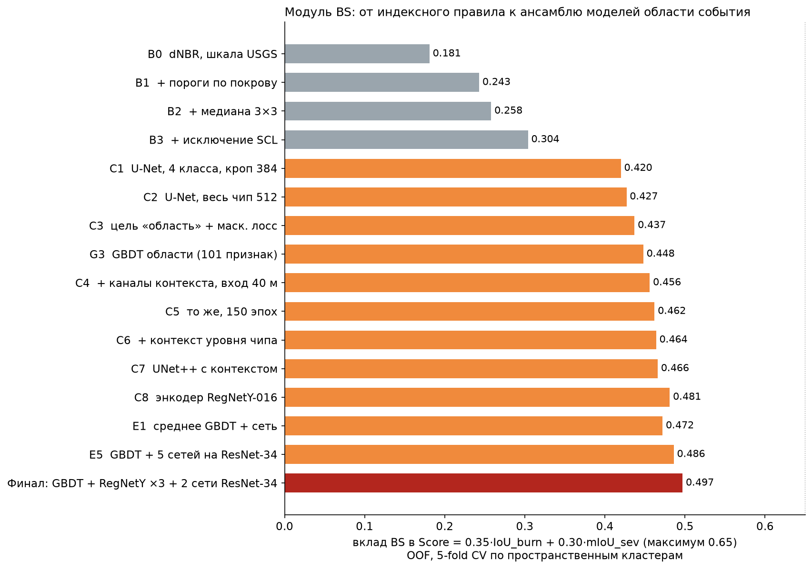
*Рис. 6.1. BS: вклад в Score (`bs_part`) на каждом шаге — от индексного правила (серые) к моделям области события (оранжевые) и финальному ансамблю (красный). OOF, 5-fold CV по пространственным кластерам.*

### 6.3 Абляции и отвергнутые гипотезы

| Гипотеза | Результат | Вывод |
|---|---|---|
| Степень от сети (argmax 4 классов) вместо правила | −0.011…−0.024 bs_part на каждом из 5 фолдов | Правило точнее: эталон — детерминированная функция dNBR |
| Модель степени (GBDT по dNBR и составу покрова в окнах 3–17 px) | согласие внутри гари 0.986 → 0.989, bs_part +0.0014 | Эффект есть, но ~10 с CPU на тесте — невыгодно при лимите 30 с |
| Калибровка границы классов 2/3 для леса и болот | согласие 0.907→0.919 и 0.928→0.943 | Принята |
| «Один пожар на чип»: оставить главную компоненту области | −0.007…−0.010 | У эталона медиана 8 компонент на чип — гипотеза неверна |
| Морфологическое закрытие / заливка дыр области | −0.001…−0.003 | Вероятности сети уже гладкие |
| Автоконтекст: GBDT 2-й ступени по карте вероятностей 1-й | со слабой сетью +0.009, с сильными −0.004 | Переобучается на OOF-признаках; в финал не вошёл |
| Более ёмкий GBDT (127 листьев, 1200 деревьев) | 0.4452 → 0.4445 | Ограничение — признаки, а не ёмкость |
| Вход сети в полном разрешении 20 м с контекстом | f0/f1 0.457/0.448 против 0.469/0.462 на 40 м | Вход 40 м лучше и в 1.6 раза быстрее |
| Энкодер ResNet-50 вместо ResNet-34 (C4) | 0.456 → 0.427 | На 224 чипах больший энкодер переобучается |
| Разные пороги области для классов правила 1/2/3 | +0.0004 | Шум; оставлен единый порог |
| Грубее вход сети: ×4 (80 м) | 0.445; в бленде вес 0 | Нестабилен по фолдам (±0.05) |
| Больше эпох (250 вместо 150) / второй seed | 0.460 / 0.461 против 0.462 | Равноценны; взяты в ансамбль ради устойчивости |
| Энкодеры (U-Net, контекст, 150 эпох): ResNet-18 / ResNet-34 / ResNet-50 / RegNetY-008 / **RegNetY-016** / RegNetY-032 / RegNetY-040 / RegNetX-016 / EfficientNet-B2 / SE-ResNeXt-26d / ECA-ResNet-26t | 0.451 / 0.462 / 0.427 / 0.480 / **0.481** / 0.479 / 0.473 / 0.456 / 0.476 / 0.471 / 0.466 | RegNetY — лучший; в финал вошли RegNetY-016 (2 seed) и RegNetY-032 |
| Декодеры: DeepLabV3+, MAnet, FPN, UNet++ (ResNet-34) | слабее на 3 фолдах из 3 / 0.461 / 0.449 / 0.466 | UNet++ в финале |
| lr 1e-3 вместо 5e-4; вес soft-IoU 2.0 вместо 0.5 | 0.448; 0.453 | Не приняты |
| U-Net без контекста (вход 20 м) в ансамбле с сетями уровня 2 и UNet++ | вес 0 при переборе | Исключена из финала: заодно самая дорогая на инференсе |
| Исключение SCL=8 (облако средней вероятности) | ±0.001, у ансамбля хуже | Не принято (в полупустыне SCL путает грунт с облаком) |
| Сверточная сеть для AF (U-Net по 117 картам признаков) в ансамбле с бустингом | сеть одна 0.899; бленд не лучше бустинга (0.962) | Бустинг на точных контекстных статистиках уже извлекает всё; не принято |

**Объяснение эффектов.**

1. Главный скачок B3→C1 (+0.12) — модель области отделяет поля и фенологию от пожара. Правило этого не умеет в принципе.
2. Скачки C3→C4 и E1/E2 — дальний контекст и ансамбль моделей разной природы. Область события — объект масштаба 3–5 км. Сеть без явных контекстных каналов и GBDT без пространственной свёртки видят его по-разному, поэтому их ошибки слабо коррелированы.
3. Цель «область» с маскированным лоссом (+0.010) — сеть не тратит ёмкость на пиксели, судьба которых уже решена правилом.


### 6.4 Вторая серия: поиск резерва поверх финального ансамбля

После фиксации ансамбля мы отдельно проверили, остался ли резерв. Эталон для сравнения — финальный бленд (0.4940) и одиночная сеть RegNetY-016 (0.4814; второй seed — 0.478, то есть шум одного 5-fold прогона ≈ ±0.003). Полный список — `reports/experiments_log.md`, серия D.

**Где именно ошибается ансамбль (OOF).** Ошибка сконцентрирована: 30 чипов из 224 дают 49 % ошибочных пикселей, идеальный прогноз на 10 худших поднял бы IoU_burn с 0.756 до 0.804. Вероятности бленда откалиброваны (в бинах 0.1–0.2 … 0.9–1.0 доля гари 0.16 … 0.95), при этом 37 % ложных пикселей имеют P > 0.8, а 41 % пропущенных — P < 0.2. Это «уверенные» ошибки: на снимке гарь есть, но дуга буфера вокруг термоточек её отсекла (или наоборот). Модель здесь не ошибается в смысле снимка — она не может знать, где проходил спутник с тепловым каналом.

| Гипотеза | Результат (bs_part) | Вывод |
|---|---|---|
| Каналы положения в чипе (чипы вырезаны вокруг события: доля гари среди допустимых пикселей падает от 0.60 в центре до 0.24 в углах) | сеть 0.4808, GBDT 0.4471 | Приор сеть извлекает сама (паддинг); явные каналы ничего не добавляют |
| Регуляризация рецепта: EMA весов / stochastic depth 0.1 / weight decay 1e-2 / scSE в декодере / Lovász hinge / вспомогательная голова «доля гари в чипе» | 0.4655 / 0.4729 / хуже на 3 фолдах из 5 / 0.4770 / в пределах шума / в пределах шума | Базовый рецепт — локальный оптимум; EMA вредит из-за усреднения статистик BatchNorm на 180 чипах |
| **Видимый огонь на Sentinel-2** (B12 > 0.5, B12 > 1.17·B11, B12 > 2·B8A): расстояние до пикселей активного горения на снимках «до» и «после» — единственное прямое указание на место термоточек | сеть 0.4663 / 0.4815 (два seed), GBDT 0.4474 | Огонь виден на 45 чипах из 224, но фронт в момент съёмки S2 (≈11:30) не совпадает с очагами VIIRS (≈13:30 и ночь), по которым построен буфер. На «чипах с огнём» выигрыша нет (0.451 против 0.455) |
| **Порядок операций в правиле степени:** класс по сырому dNBR → исключённые по SCL в 0 → медиана 3×3 по растру классов (вместо «медиана dNBR → класс») | согласие внутри гари 97.17 % → 97.65 %; бленд 0.4937 → **0.4960** (mIoU_sev 0.764 → 0.771); парный бутстреп по пространственным кластерам: +0.0017…+0.0031 (95 %), прирост на всех 5 фолдах | **Принято** — единственное улучшение серии. Это уточнение понимания эталона, а не подгонка: правило детерминировано, параметров не добавляет. Варианты хуже: медиана-«крест» 0.4879, окно 5×5 0.4728, медиана без обнуления исключённых 0.4958, игнорирование исключённых соседей 0.4959, мода 3×3 — согласие 95.1 %; перекалибровка порогов под новое правило даёт +0.00003 — не берём |
| **Минимальная площадь объекта:** в эталоне нет гарей мельче 25 px (1 га) — из 4 997 связных компонент меньше только 4; сито того же размера на итоговой маске прогноза | бленд 0.4960 → **0.4967**; по фолдам +0.0008 / +0.0008 / +0.0008 / +0.0005 / +0.0006; сито 12 / 20 / 30 / 40 px: +0.0006 / +0.0008 / +0.0005 / +0.0001; public 0.8615 → 0.8622 | **Принято.** Размер взят из эталона (25 px), а не подобран по метрике: 20 px на OOF на 0.0001 лучше, но эталону не соответствует. Заливка мелких дыр не принята: в эталоне они есть |
| Сдвиг порога 0\|1 в гейте правила на ±0.0025…0.02 | 0.4926 … 0.4761 | Пороги постановки точны до третьего знака: любое смещение теряет |
| Форма окна медианы dNBR (крест 5 px, круг r = 2, 5×5, медиана на сетке 10 м, медиана NBR до разности) | согласие с эталоном 0.954 / 0.954 / 0.923 / 0.927–0.944 / 0.946 против 0.972 | Квадрат 3×3 подтверждён |
| Энкодеры другой природы вместо RegNetY: PVTv2-B2 / ConvNeXt-Tiny / MaxViT-Tiny / EfficientNetV2-S | одна сеть 0.4626 / 0.4519 / 0.4717 / 0.4670 против 0.4814; в бленде +0.0002 / 0.0000 / +0.0013 / −0.0013 | Глобальное внимание не помогает: неопределённость не в рецептивном поле, а в самой разметке. Прирост бленда ниже порога значимости и стоит +4 с инференса |
| Автономная очередь из 32 вариантов рецепта RegNetY-016 на 5 GPU: сглаживание меток, soft bootstrapping и обобщённая кросс-энтропия (устойчивость к шуму разметки без учителя); отключение групп входных каналов и шум входа; lr, число эпох, batch, вес soft-IoU, weight decay; обучение без диэдральных аугментаций; инициализация первого слоя ImageNet-ядрами по спектральным каналам; пять seed базового рецепта | шум между seed: одиночная сеть 0.473–0.483 (СКО 0.004); отключение каналов p = 0.15 дало 0.4841 и 0.4963 в бленде, но второй seed — 0.4706 и 0.4924; без аугментаций 0.4514; SWIR-инициализация 0.4891 | Каждый «выигрыш» проверялся вторым seed и не подтверждался: без такой проверки мы приняли бы шум за улучшение. SWIR-инициализацию проверили отдельно — следующая строка |
| **SWIR-инициализация первого слоя** (ImageNet-ядра ставятся на B12, B11, B8A «до» и «после», остальные каналы с нуля) — кандидат в финал | одиночная сеть 0.490 при двух seed (лучше всех пяти обычных seed); замена двух сетей в бленде 0.4960 → 0.4995, по фолдам +0.001 / −0.001 / +0.017 / +0.009 / −0.007; полная проверка кандидата пройдена; **public 0.8570 против 0.8615** | **Отвергнуто.** Кандидат — лучший из ~35 вариантов, отобранных на одном OOF («проклятие победителя»), прирост неравномерен по фолдам, а независимая проверка на public дала −0.0045. Правило степени, напротив, подтвердилось и на OOF, и на public. Финал не менялся |
| Усреднение членов ансамбля по логитам / геометрическое / среднеквадратичное; вес GBDT 1.5–2.5 | 0.4929 / 0.4881 / 0.4909; 0.4950–0.4923 | Арифметическое среднее вероятностей лучше; вес GBDT — плато |
| AdaBN: переоценка статистик BatchNorm на неразмеченных чипах нового кластера | 0.4820 против 0.4814 | Сдвиг между территориями статистики BatchNorm не задевает — косвенное подтверждение переносимости |
| AF: «точный» контекстный тест VNP14IMG как признаки (фон без «фоновых очагов», динамическое окно 11–31 px, MAD, запасы по четырём тестам у пикселя и соседей) | F1 0.9629 против 0.9619 | Шум. Ночью эталон почти точно равен «проходит тест» (1188 из 1191 пикселей), а 466 прошедших, но не размеченных — удалённые организаторами постоянные источники (у 71 % рядом застройка): по одному снимку их не отличить. Днём согласие теста с эталоном 84 % — бустинг на статистиках уже точнее. Эталон и каналы пересчитаны на сетку одинаково (метки внутри пар пикселей-дубликатов совпадают в 99.6 % случаев), то есть «шум краёв» — не сдвиг привязки, а порог контекстного алгоритма в геометрии полосы, которой в чипе нет |
| AF: вторая ступень (автоконтекст по карте вероятностей: соседи, окна 3–11, размер кластера) | F1 0.9592; в бленде 0.9623 | Не лучше 0.9619: 57 % FP и 70 % FN лежат на краю кластеров — это шум геопривязки эталона |
| TTA 8 → 4 → 1 | 0.4940 → 0.4929 → 0.4917 | TTA 8 оставлен; все варианты TTA идут через сеть одним батчем (сети BS 20 с → 14.6 с на RTX 3060) |

**Дистилляция ансамбля и утечка в кросс-валидации.** Самая поучительная проверка серии. Идея: граница области в эталоне во многом случайна, поэтому ученика можно учить на мягкой цели `alpha·эталон + (1 − alpha)·P_OOF(бленд)`. Обычная 5-fold CV показала огромный прирост одиночной сети: 0.4814 → 0.4896 (alpha 0.7) → 0.4990 (0.5) → **0.5076** (0.3) — одиночная сеть «обогнала» весь ансамбль-учитель (0.4940), а прирост монотонно рос с долей учителя. Это признак утечки: OOF-прогноз учителя для обучающего чипа сделан моделями, видевшими разметку валидационного фолда ученика; подражая им, ученик перенимает и заученное ими. Мы проверили это вложенной CV (`--drop-fold`: учителя обучены без валидационного фолда ученика; alpha 0.3, один учитель RegNetY-016):

| Фолд | обучение на эталоне (seed 42 / 7) | ученик, «честный» учитель | ученик, учитель с утечкой |
|---|---|---|---|
| 0 | 0.509 / 0.514 | 0.501 | 0.534 |
| 2 | 0.421 / 0.443 | 0.446 | 0.465 |

Честный ученик не лучше обучения на эталоне: весь «прирост» — утечка. На тесте учителя чипов не видели, значит, прироста не будет, и дистилляция в финал не вошла (то же у GBDT на мягких целях: 0.4530 против 0.4481). Практический вывод для протокола: любые схемы, где модель учится на OOF-прогнозах других моделей, нужно проверять вложенной кросс-валидацией — иначе CV завышает качество на величину, сравнимую со всем выигрышем ансамбля.

**Итог серии.** Из моделей ни одна гипотеза не дала устойчивого прироста ≥ 0.002 (перспективные варианты повторялись с другим seed и не подтверждались), поэтому состав и веса ансамбля не менялись. Приняты два изменения, и оба — уточнения процедуры эталона, а не моделей: правило «медиана классов» (+0.0023) и минимальная площадь объекта 1 га (+0.0007); оба подтвердились на public (0.8596 → 0.8615 → 0.8622). Кроме них серия дала: (1) ускорение инференса на 26 % (34 с → 25 с на RTX 3060) при тех же весах моделей — батчевый TTA, прореженный GBDT (−0.0003), приоритеты процессов; (2) понимание, что остаточная ошибка BS — в основном неустранимый по снимкам шум процедуры разметки, а не недообученность; (3) проверенную границу применимости OOF-оценок.


## 7. Инженерные и предметные решения

| Проблема постановки | Как решено в пайплайне | Почему улучшает качество |
|---|---|---|
| **Сильный дисбаланс** (AF 1 : 2 829) | Двухступенчатая схема «мягкие кандидаты → бустинг» и порог по F1 на OOF; в сети AF — pos_weight и soft-Dice | Классификатор решает задачу, где классы соизмеримы (2.6 % положительных среди кандидатов). Порог оптимизирует ту же F1, что и метрика |
| **Облака и тени по SCL** | Жёсткое исключение SCL {0,3,6,9,11} на обеих датах (правило подтверждено статистикой эталона); остальные классы SCL — входы сети и GBDT | +0.066 IoU_burn и +0.075 mIoU уже у правила (B2→B3). Модели учатся на «чистых» пикселях. Мягкие классы (8, 10, 2) не выбрасываются: среди них много настоящей гари |
| **Ошибки SCL в полупустыне** (сухой грунт принят за облако) | Класс 8 (облако средней вероятности) не исключаем. Сеть видит SCL и отражение и сама решает, облако это или грунт | Исключение класса 8 на OOF не даёт устойчивого прироста: ±0.001 у отдельных моделей, у ансамбля хуже на 0.001–0.002 |
| **Полосы NaN и доля валидных пикселей (AF)** | Валидность считаем сами по пикселям (I4 и I5 конечны, `valid` = 1), а не по `meta.valid_frac`. Фоновые статистики окон 7–41 px берутся только по валидным пикселям; доля валидных в окне и в чипе — отдельные признаки | Полосы bow-tie есть у 52 % чипов train и 57 % чипов test, 11 % пикселей горения граничат с NaN. `meta.valid_frac` их не описывает (он < 1 лишь у 14 чипов), поэтому опора на метаданные дала бы смещённый фон у каждого второго чипа |
| **Техногенные и отражающие объекты (AF)** | Доли застройки, пашни и воды в окнах; I3 и I3/I2 (блик в SWIR); I4 − T2m; признаки уровня снимка | Точность 0.81 → 0.953 при полноте 0.971. Однако 134 одиночных FP остаются: факел по одному снимку неотличим от пожара, а историю тестовых точек использовать нельзя |
| **Тип покрова и степень** | Пороги dNBR по группе покрова; граница классов 2/3 для леса и болот откалибрована по эталону | mIoU при идеальном контуре 0.97; B0→B1: mIoU 0.18 → 0.40 |
| **Рельеф** | Высота относительно среднего по чипу и уклон — входы сети и GBDT | Рельеф объясняет часть вариаций освещённости склонов; абсолютная высота не используется, чтобы не привязываться к территории |
| **Радар** (облака, дым) | VV/VH до/после, разности, сглаженные 7×7 разности, маска покрытия — вспомогательные каналы | Сигнал слабый (AUC 0.53–0.62), поэтому радар — подсказка сети там, где оптика неуверенна, а не самостоятельный детектор |
| **Фенология «до/после»** (уборка, вспашка, засуха) | Модель учится не «изменению», а «области события». Признаки реального выгорания (изменение red-edge B5, NBR после, SWIR) и расстояние до ядер сильной гари | Поля с убранным урожаем вне области события — главный источник ложных контуров у порогового метода. IoU_burn 0.427 → 0.756 |
| **Дальний контекст** (область ~3 км = 150 px) | Каналы плотности и расстояний для сети; окна 160 м–5 км для GBDT; вход сети 40 м | Та же сеть без контекстных каналов: 0.437 → с каналами 0.456 (вклад BS) |
| **Скорость (<30 с на H100)** | Признаки AF и BS считаются в torch батчем на GPU. Все 8 вариантов TTA идут через сеть одним батчем на уже уменьшенном входе (на быстрых GPU время упирается в запуск ядер, а не в счёт). GBDT BS — пул процессов с пониженным приоритетом, созданный до CUDA: воркеры сами читают растры и работают параллельно с сетями; деревья считаются для «шахматной» половины блоков 40 м, остальные блоки — среднее соседей (область события — гладкий объект масштаба километров). Число процессов подбирается по cpuset и квоте CPU контейнера. При сборке сетей пропускается инициализация весов (их сразу заменяет чекпойнт). Чтение растров — пулом потоков (GDAL отпускает GIL) | Весь тест (269 чипов): **25.1 с** на RTX 3060 + 12 ядер CPU, в Docker 27 с вместе с запуском контейнера (первая версия пайплайна — 34 с). Из 25 с сети BS на GPU занимают 14.5 с, загрузка библиотек и весов — 7.5 с, AF — 2.6 с. На H100 сети считаются в разы быстрее — ожидаем ~10 с. Цена ускорений по качеству: прореженный GBDT −0.0003 `bs_part` (0.4940 → 0.4937), остальное — без изменения результата |
| **Надёжность инференса** | Нехватка памяти GPU → батч делится пополам, в пределе — CPU; иной сбой батча → поштучная обработка → запасной ответ (пустая маска AF / вероятность только по сетям для BS при сбое GBDT). Валидатор сабмита повторяет все формальные проверки | Прогон всегда завершается кодом 0 с полным набором 447 строк; RLE проверен тестами и сквозным прогоном на псевдотесте из train |

**Точный инференс деревьев на GPU.** Мы реализовали обход деревьев LightGBM на torch (`firemon/gbdt_torch.py`; совпадает с `Booster.predict` до 1e-7, тест `tests/test_gbdt_torch.py`). В финальном пайплайне он не нужен: параллельный CPU-вариант укладывается в бюджет и не зависит от GPU.


## 8. Итоговое решение

**AF.** 117 контекстных признаков → кандидаты → ансамбль 3 LightGBM (seed 142–144, весь train) → порог 0.575. OOF: **F1 0.962** (P 0.953, R 0.971).

**BS.** Вероятность области события — взвешенное среднее шести моделей:

| Модель | Вес | Одна, bs_part (OOF) |
|---|---|---|
| GBDT области (LightGBM, 101 признак, блоки 40 м; в инференсе деревья считаются для половины блоков) | 1.0 | 0.448 (прореженный — 0.446) |
| U-Net **RegNetY-016**, контекст уровня 1 (94 канала), seed 42 | 1.0 | 0.481 |
| U-Net RegNetY-016, контекст уровня 1, seed 7 | 1.0 | 0.478 |
| U-Net RegNetY-032, контекст уровня 1 | 1.0 | 0.479 |
| U-Net ResNet-34, контекст уровня 2 (104 канала: + статистики чипа) | 0.5 | 0.464 |
| UNet++ ResNet-34, контекст уровня 1 | 0.5 | 0.466 |

Все сети — цель «область события», вход 40 м, весь чип, 150 эпох. Порог 0.475 → ∩ уточнённое правило (медиана 3×3 по растру классов, раздел 2.2 а) ∩ не исключено по SCL → удаление объектов мельче 25 px (1 га) → класс по этому же правилу. Сети обучены на всём train (224 чипа), инференс с 8 диэдральными TTA. Бленд с полным GBDT даёт на OOF 0.4940, с прореженным — 0.4937; мы выбрали второй: разница на порядок меньше шума между seed, а работа CPU в инференсе вдвое меньше (раздел 7).

**Почему именно так.**

* Энкодер RegNetY дал самый большой архитектурный выигрыш (+0.019 одиночной сети), поэтому основа ансамбля — три сети на RegNetY (два seed RegNetY-016 и RegNetY-032). Сети на ResNet-34 с контекстом уровня 2 и с декодером UNet++ добавлены с меньшим весом ради разнообразия ошибок.
* Бленд насыщается на уровне 0.493–0.494: любой из десятка проверенных составов даёт разницу ≤ 0.001. Мы выбрали разнообразный состав с весами на грубой сетке.
* Несколько сетей одной конфигурации (разные seed) дают устойчивость: разброс между seed на отдельных фолдах достигает ±0.05.
* Все сети работают на входе 40 м: пять сетей плюс GBDT укладываются в 25 с на RTX 3060.
* Вторая ступень GBDT и модель степени дают прирост ≤ 0.002 ценой усложнения и времени — отказались.

**Итоговые метрики (OOF, 5-fold, пространственные кластеры):**

| Компонента | Значение | Вклад в Score |
|---|---|---|
| F1_af | 0.962 | 0.337 |
| IoU_burn | 0.757 | 0.265 |
| mIoU_sev (слабая / средняя / сильная) | 0.772 (0.634 / 0.798 / 0.885) | 0.232 |
| **Score** | **0.833** | |

Для сравнения: классический baseline — 0.493, лучший чисто правиловой вариант — 0.615.

**Внешняя проверка.** Финальный сабмит (md5 `b159562917dcaf5b42f906f269a05b82`) получил на платформе **0.8622** (public-часть теста, 2019–2024). Оба уточнения процедуры эталона проверены на public по отдельности: прежнее правило сборки маски — 0.8596, правило «медиана классов» — 0.8615 (+0.0019 при +0.0023 на OOF), минимальная площадь объекта — 0.8622 (+0.0007 при +0.0007 на OOF). Кандидат с SWIR-инициализацией двух сетей, выигравший на OOF, на public дал 0.8570 и был отвергнут (раздел 6.4). Разница между public и OOF может объясняться составом событий в public, пространственным разбиением CV и обучением финальных моделей на всём train вместо 4/5; отдельные причины мы не измеряли. Public-оценка и OOF не определяют результат на private: там другой год и другие территории.

**Сервис.** Веб-интерфейс и REST API со Swagger (`/docs`); запуск локально — `uvicorn` или `docker compose` (README). Пользователь задаёт территорию (AOI, прямоугольник, полигон на карте или файл GeoJSON) и период. Сервис показывает термоточки VIIRS, контуры гарей и попиксельный растр степени 20 м, снимки Sentinel-2 до и после пожара, и формирует справку:

* площадь гарей в гектарах — по пикселям 20 м в проекции UTM своей зоны, а не в градусах; для контура, обрезанного границей запроса, площадь пересечения считается в той же зоне UTM по точной попиксельной геометрии;
* площади и доли слабой, средней и сильной степени, распределение по типам покрова, динамика термоточек;
* сравнение модели с эталоном на той же территории: IoU и F1 гарей, точность степени, F1 термоточек.

Выгрузка — GeoJSON, Shapefile (`.prj`, `.cpg`), GeoPackage, CSV, JSON, ZIP; у каждого объекта — идентификатор, класс, площадь; система координат — WGS84 или UTM. Всё, что есть в интерфейсе, доступно через REST API (GET и POST). Каталог сервиса построен на OOF-прогнозах модели по сценам train: у тестовых чипов нет геопривязки. Подложка векторная, собственного стиля, без государственных границ.


## 9. Выводы, ошибки, ограничения, развитие

### 9.1 Что дало основной вклад

1. **Понимание устройства эталона** (разделы 2.2 и 5.1): степень восстанавливается правилом с согласием 99.1 %, SCL-исключение и гейт по правилу делают маску совместимой с эталоном «по построению». Одно это без обучения поднимает вклад BS с 0.181 до 0.304.
2. **Постановка «область события» вместо «гари»** с маскированным лоссом и дальним контекстом (каналы плотности и расстояний, грубый вход сети): +0.03–0.04 к вкладу BS против обычной сегментации.
3. **Энкодер RegNetY и ансамбль моделей разной природы** (сети + GBDT на явных многомасштабных признаках): RegNetY +0.019 к одиночной сети, ансамбль +0.013 к лучшей одиночной модели.
4. **AF:** замена жёстких порогов VNP14IMG обучаемым решением на тех же контекстных статистиках: F1 +0.071.

### 9.2 Какие ошибки остаются (анализ OOF)

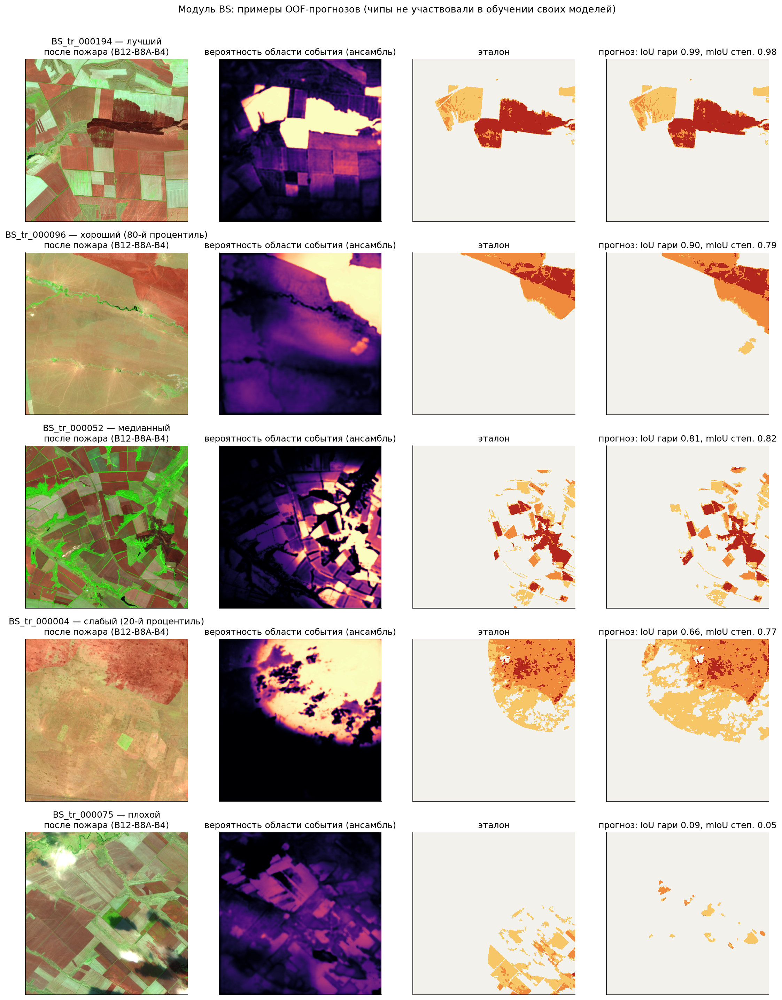
*Рис. 9.1. BS, OOF-прогнозы: лучший, 80-й процентиль, медианный, 20-й процентиль и худший чип. Слева — снимок «после», далее вероятность области события, эталон и прогноз. У чипа BS_tr_000004 (20-й процентиль) эталон срезан дугой окружности, а модель продолжает гарь за неё — это и есть главный тип ошибки.*

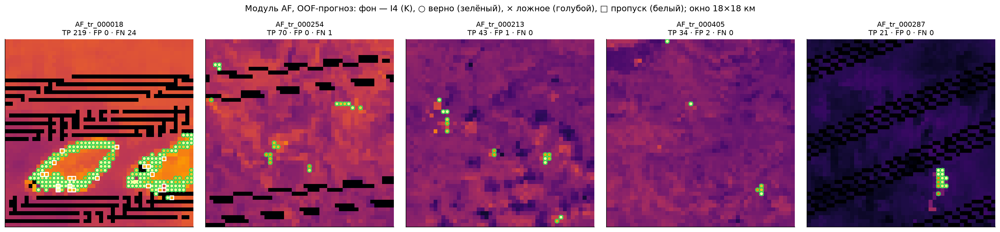
*Рис. 9.2. AF, OOF-прогнозы: фон — I4, чёрным — полосы NaN (bow-tie). Ошибки сосредоточены на краях кластеров: у AF_tr_000018 при 219 верных пикселях 24 пропуска, все по контуру.*

**Ошибка BS сильно сконцентрирована.** 30 чипов из 224 дают 49 % всех ошибочных пикселей (FP + FN) финального ансамбля. «Оракульный» порог вероятности, свой для каждого чипа, поднял бы IoU_burn с 0.756 до 0.787 — то есть основная неопределённость не попиксельная, а на уровне чипа: «какая часть изменений dNBR относится к этому событию». Это же видно по геометрии: чипы вырезаны вокруг события, и доля гари среди пикселей, допустимых правилом, падает от 0.60 в центре чипа до 0.24 в углах. В худших чипах эталон — один-два круга радиусом ≈2.5 км, отсекающие часть сплошной гари, либо «не те» убранные поля на пашне.

| Тип остаточной ошибки | Масштаб | Причина | Что пробовали | Что делать дальше |
|---|---|---|---|---|
| **BS: контур обрезан буфером** — большие степные пожары, где гарь на снимке продолжается за дугой эталона (чипы 16, 112, 4) | Основной источник FP; 30 чипов дают 49 % ошибочных пикселей | Эталон = правило ∩ буфер ≈3 км вокруг очагов, зафиксированных VIIRS. Часть пожара без очагов (или соседнее событие) в эталон не вошла. По паре снимков граница неразличима | «Один пожар на чип» −0.007…−0.010; морфологическое закрытие и заливка дыр −0.001…−0.003; отдельные пороги для классов правила +0.0004. Оракульный порог по чипу дал бы +0.031 IoU_burn — значит резерв есть, но он в оценке масштаба события, а не в постобработке | Явная модель «плотность очагов → дилатация диском R ≈ 3 км» вместо свободной сегментации (9.4, п. 2). В оперативном контуре — прямая связка с термоточками AF: буфер 3 км даёт IoU 0.69 даже на неполных очагах (9.4, п. 1) |
| **BS: ложные контуры на убранных полях** — убранные или сожжённые по стерне поля со сходным dNBR вдали от очага | Второй из двух типов ошибки, преобладающих в худших чипах | Уборка и вспашка за 10–50 дней между снимками дают тот же dNBR. Внутри зоны правила dNBR отличает гарь с AUC всего 0.69 (травы и пашня 0.69) | Признаки реального выгорания: изменение red-edge B5 — первый по gain у GBDT; дальний контекст и расстояния до ядер сильной гари (+0.019); радар как проверка контура — ΔVH 7×7 даёт AUC 0.51 на травах и пашне, где лежит 94 % гари, и в жёстком виде не применим | Временные ряды S2 (несколько дат «после»): у поля спектр восстанавливается иначе, чем у гари; SAR-когерентность вместо интенсивности (9.4, п. 4) |
| **BS: пропуск малых и слабых гарей** — длинные узкие полосы низкой степени | FN меньше FP; бьёт прежде всего по классу 1 (IoU 0.632 против 0.885 у сильной) | Слабая степень — 40 % гари, её dNBR вплотную к порогу «не горело», а сеть на входе 40 м не уверена в тонких полосах | Вход в полном разрешении 20 м — хуже (0.457/0.448 против 0.469/0.462 по фолдам); порог бленда перебран по OOF; морфология не помогает | Порог, зависящий от размера и средней уверенности связной компоненты (а не единый по чипу) — та же линия, что и оракульный порог по чипу |
| **BS: смешение соседних классов степени** | Почти отсутствует: ≈1.4 % пикселей внутри гари | Правило ошибается на границах классов (3.4 % против 0.3 % внутри) и на краях лесных массивов, где эталон, по-видимому, брал покров в другом разрешении | Калибровка границы 2\|3 для леса и болот 0.907→0.919 и 0.928→0.943 — принята; GBDT-модель степени 0.986→0.989 согласия (+0.0014 `bs_part`) — отвергнута из-за ~10 с CPU при лимите 30 с; мажоритарное сглаживание карты покрова (0.986 / 0.984 / 0.981 для окон 3 / 5 / 9) — не принято | Вернуть модель степени, если бюджет времени вырастет; она бьёт ровно по лесным краям |
| **AF: сдвиг ±1 пиксель по краю кластера** | 60 % всех ошибок AF | Шум совмещения эталона (продукт VIIRS) с сеткой чипа 375 м. Кластеры горения мелкие — медиана 2 px, 41 % кластеров одиночные, — поэтому почти каждый пиксель горения оказывается краевым | Отсортированные значения 8 соседей (A7) — ±0.000; U-Net-сегментатор по тем же картам признаков (A9) — 0.899 одна, в бленде 0.962, без прироста | Неустранимо по одному снимку без субпиксельной привязки; дальнейшие усилия по AF выгоднее тратить на техногенные источники |
| **AF: одиночные техногенные источники** | 134 FP из 465 | Факел или промплощадка по одному снимку неотличимы от пожара; сам эталон помечает горячую застройку пожаром лишь в 49 % случаев, то есть статической маски в нём нет | Доли застройки, пашни и воды в окнах, блик в SWIR (I3, I3/I2), I4 − T2m: точность 0.807 → 0.953 | Каталог постоянных источников по многолетнему архиву (зимние срабатывания, 9.4, п. 3) — в сервисе это законно и даст больше любых признаков одного снимка; в соревновании запрещено (тест обезличен) |
| **AF: пропуск слабых очагов у порога** | 85 одиночных FN | Очаги лежат ровно на порогах VNP14IMG; часть теряется ещё на отборе кандидатов (полнота 99.64 % ≈ 35 пикселей) | Порог решения взят в середине плато F1 (ширина плато ±0.001); мягкие пороги кандидатов уже опущены до 310 K / 12 K днём и 290 K / 6 K ночью | Отдельная модель для изолированных кандидатов; расширение отбора кандидатов с перевзвешиванием. Потолок виден заранее: даже полное устранение этих 85 FN меняет полноту с 0.971 до 0.980 |

### 9.3 Ограничения подхода

* *По данным:* модель области учится воспроизводить конкретную процедуру разметки (буфер ~3 км вокруг очагов). На другой методике разметки (например, наземные контуры) веса надо переобучить, хотя признаки и схема остаются. Степень поражения относительна типу покрова и не сопоставима напрямую с лесной шкалой.
* *По применимости:* нужен безоблачный «после»-снимок в течение 2–4 недель (травяная гарь зарастает); облака, тени и снег по SCL дают «дыры» в контуре. AF не использует историю наблюдений — фильтр постоянных факелов по многолетнему архиву в сервисе даст больше, чем любые признаки одного снимка.
* *По вычислениям:* инференс тестового набора — 25 с на RTX 3060 (+12 ядер CPU), ожидаемо ~10 с на H100. Обучение всего решения — около часа на одной такой карте.

### 9.4 План развития

1. **Связать модули.** В сервисе у нас есть термоточки AF той же территории и времени. Буфер ~3 км вокруг обнаруженных очагов — почти прямой предиктор области события (IoU 0.69 при R = 3 км даже на неполных очагах). В оперативном контуре это даст больше любого улучшения сети. В соревновании так делать нельзя: тестовые чипы обезличены.
2. **Явная модель области как объединения дисков.** Предсказывать плотность очагов и раскрывать её дифференцируемой дилатацией диском R ≈ 3 км вместо свободной сегментации. Это единственная линия, которая бьёт прямо по главному источнику ошибки (раздел 9.2): почти вся остаточная неопределённость — не попиксельная, а «где обрывается событие», и оракульный порог на уровне чипа стоит +0.031 IoU_burn.
3. **Каталог постоянных источников** по многолетнему архиву (зимние срабатывания) — маска факелов для оперативного контура AF.
4. **Временные ряды S2** (несколько дат «после») для устойчивости к зарастанию и облакам; SAR-когерентность вместо интенсивности.
5. Модель степени у лесных краёв (+0.0014, раздел 6.3). Дистилляцию ансамбля мы проверили (раздел 6.4): с «честным» учителем прирост качества нулевой. Как способ заменить пять сетей одной ради скорости её стоит проверить отдельно — с ансамблем честных учителей и вложенной CV.


## 10. Воспроизводимость

* **Окружение.** Python 3.12; зависимости с точными версиями в `requirements.txt` (torch 2.6.0 / CUDA 12.4, segmentation-models-pytorch 0.5.0, timm 1.0.29, LightGBM 4.7.0, rasterio 1.5.1, numpy 2.5.3 …); `Dockerfile` на базе `python:3.12-slim` (CUDA 12.4 приходит с колёсами torch, на хосте нужен только драйвер NVIDIA и nvidia-container-toolkit).
* **Случайность.** Везде `seed=42` (`firemon.utils.seed_everything`): numpy, torch, python; фолды зафиксированы файлами `configs/folds_*.csv`; LightGBM в режиме `deterministic=True`, `force_row_wise=True`. Инференс детерминирован: TTA без случайности, пороги из конфигурации весов.
* **Инференс:** `python inference.py --data-dir <test> --output submission.csv` (веса в `weights/`). Повторный запуск даёт побитно тот же файл (проверено `cmp` двух прогонов на GPU). Docker-образ даёт файл, идентичный запуску без Docker.
* **Обучение:** `python train.py --data-dir <train>` пересоздаёт все веса. `--cv` дополнительно воспроизводит 5-fold OOF и таблицы раздела 6.
* **Числа отчёта:** `scripts/eda_report.py` (раздел 2), `scripts/baselines.py` (раздел 3), `scripts/bs_oof_analysis.py`, `scripts/bs_blend_search.py`, `scripts/bs_gbdt_cv.py` (раздел 6), `scripts/validate_submission.py` (формат и метрика сабмита).
* **Железо разработки:** серверы с RTX 3060 12 ГБ, 12 ядер CPU (в первой серии экспериментов — 2 GPU, во второй — до 5 GPU параллельно); все замеры времени — на одной RTX 3060. Обучение одной сети BS (150 эпох, весь train, с кэшем признаков) ~5–7 мин, GBDT BS ~10 мин на CPU, AF ~10 мин.

## 11. Лицензии и источники

* **Данные:** только выданный организаторами набор. Внешние данные и готовые продукты горения/гарей (FIRMS, MCD64A1 и др.) не использовались. Геопривязка и даты тестовых чипов не восстанавливались.
* **Источники слоёв выданного набора и их лицензии:** Sentinel-1, Sentinel-2, Copernicus DEM GLO-30 и ERA5-Land — открытая лицензия Copernicus (свободное использование с указанием источника: © Copernicus / ESA / ECMWF); VIIRS I1–I5 — общественное достояние (NASA); ESA WorldCover v200 — CC BY 4.0 (© ESA WorldCover project).
* **Предобученные модели** используются только для инициализации энкодеров; первый слой адаптирован под 94–104 канала. Точные источники: [RegNetY-016 `tv2_in1k`](https://huggingface.co/timm/regnety_016.tv2_in1k) — ImageNet-1k, torchvision через timm, **BSD-3-Clause**; [RegNetY-032 `ra_in1k`](https://huggingface.co/timm/regnety_032.ra_in1k) — ImageNet-1k, timm, **Apache-2.0**. Обе карточки опубликованы в марте 2023 года. [ResNet-34 `imagenet`](https://huggingface.co/smp-hub/resnet34.imagenet) загружается через SMP (фиксированная revision `7a57b34f723329ff020b3f8bc41771163c519d0c`); карточка с января 2025 года ссылается на исходные веса torchvision `resnet34-333f7ec4.pth`. Код torchvision — [BSD-3-Clause](https://github.com/pytorch/vision/blob/main/LICENSE); карточка зеркала помечена `license: other`, отдельная лицензия весов в ней не раскрыта. Все используемые источники существовали до начала соревнования. Лицензию библиотеки timm не распространяем автоматически на все её чекпойнты.
* **ПО (открытое):** [PyTorch](https://github.com/pytorch/pytorch/blob/main/LICENSE) (BSD-3), [segmentation-models-pytorch](https://github.com/qubvel-org/segmentation_models.pytorch/blob/v0.5.0/LICENSE) (MIT), [timm](https://github.com/huggingface/pytorch-image-models/blob/main/LICENSE) (Apache-2.0), [LightGBM](https://github.com/microsoft/LightGBM/blob/master/LICENSE) (MIT), scikit-learn (BSD-3), NumPy/SciPy/pandas (BSD), rasterio (BSD-3), pyproj (MIT), Shapely (BSD-3), FastAPI (MIT), MapLibre GL JS (BSD-3), pyshp (MIT). Лицензии локальных JS-библиотек и шрифтов (Inter, IBM Plex Mono — SIL OFL) включены в `service/static/vendor/`.
* **Подложка сервиса:** векторные тайлы [OpenFreeMap](https://openfreemap.org) по схеме [OpenMapTiles](https://openmaptiles.org), данные © участники [OpenStreetMap](https://www.openstreetmap.org/copyright) (ODbL); слой «Спутник» — Esri World Imagery. Только для отображения, в модели не используются.
* **Методы:** Schroeder W. et al. (2014) *The New VIIRS 375 m active fire detection data product* (RSE 143) — контекстный алгоритм VNP14IMG; Key C.H., Benson N.C. (2006) *Landscape Assessment: ground measure of severity (CBI) and remote sensing of severity (NBR)* — dNBR и шкала USGS; Miller J.D., Thode A.E. (2007) — RdNBR; Ronneberger O. et al. (2015) — U-Net; Radosavovic I. et al. (2020) — RegNet; Ke G. et al. (2017) — LightGBM.
